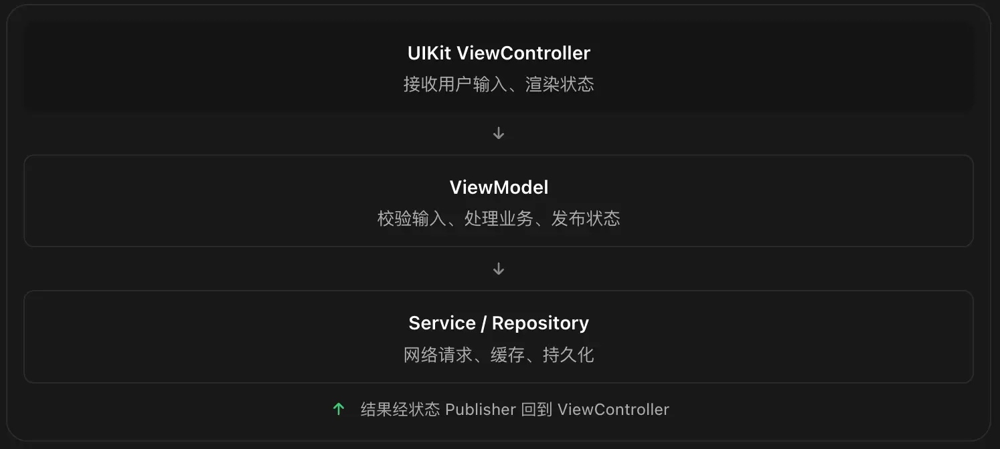
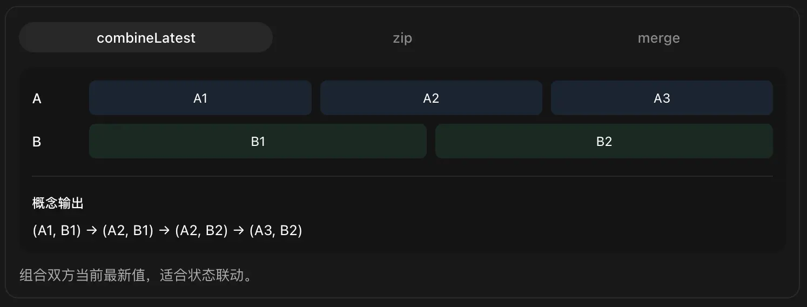
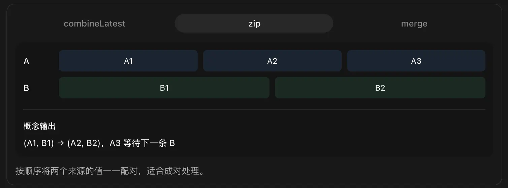
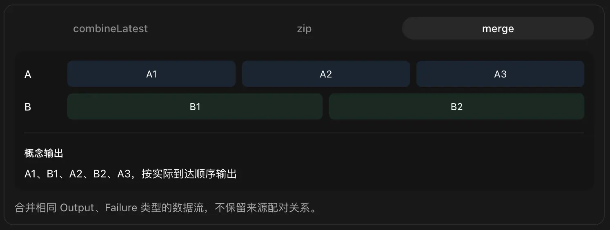
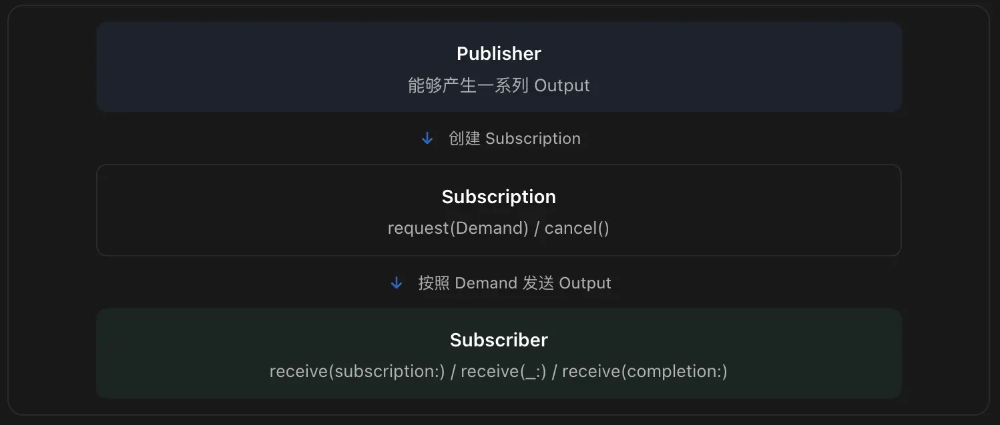

## 1. Combine基础概念

### 1.1 Combine 的三个核心角色

把 Combine 想象成一条数据传输管道：


> 不过，严格来说，Publisher 和 Subscriber 之间还有一个重要角色：`Subscription`，负责连接、请求数据和取消订阅，后面会深入。


#### 1.1.1 Publisher（发布者）

Publisher 是一个数据源，负责产生数据或事件。

常见例子：

- 输入框内容变化。
- 网络请求结果。
- 通知。
- 定时器。
- 对象属性变化。

#### 1.1.2 Operator（操作符）

负责处理 Publisher 输出的数据。

例如：

- `map`：转换数据。
- `filter`：过滤数据。
- `debounce`：防抖。
- `combineLatest`：合并多个数据源。
- `retry`：失败重试。

> 大多数 Operator 会创建一个新的 Publisher。

#### 1.1.3 Subscriber（订阅者）

负责接收最终数据。

最常见的就是：

```swift
.sink { value in
    print(value)
}
```

> `sink` 一个多义词，作名词时主要指厨房或卫生间的洗涤槽（水槽），也可指“污水坑”或“沉降池”；作动词时意为“下沉、沉没、下降”。

`sink(receiveCompletion:receiveValue:)` 是 Combine 里最基础的**订阅方式**。它把 Publisher 发出的两类事件分别交给两个闭包处理：

| 闭包 | 接收的事件 | 调用次数 | 含义 |
| :--- | :--- | :--- | :--- |
| **`receiveValue`** | 数据值（`Output`） | 0 ～ 多次 | "流里来了一个新值" |
| **`receiveCompletion`** | 完成事件（`Subscribers.Completion`） | **最多 1 次** | "流结束了，原因是成功或失败" |

任何 Publisher 对订阅者只会发出两类事件：

```
Publisher ──►  value, value, value, ...  ──►  completion
                (0~N 个值)                    (最多 1 次，且之后不再有值)
```

`completion` 又有两种：

```swift
enum Subscribers.Completion<Failure> {
    case finished          // 正常结束，没有错误
    case failure(Failure)  // 以错误结束
}
```

所以 `sink` 本质上是：

```swift
.sink(
    receiveCompletion: { [weak self] completion in
        // 流终止时调用一次
        // completion 要么是 .finished，要么是 .failure(error)
         switch completion {
          case .finished:
            print("流正常结束")
            // 停止 loading、标记请求完成、触发下一步流程等
          case .failure(let error):
            print("流以错误结束：\(error)")
            // 弹错误提示、记录日志、重试、降级展示、停止 loading 动画。
         }
         // 比如 关闭连接、取消计时器、恢复按钮可点击状态。
    },
    receiveValue: { [weak self] value in
        // 每来一个值调用一次
        // 比如更新UI、写入 ViewModel 、播放动画、埋点、跳转、刷新 table、切换页面状态。
    }
)
```

> **关键顺序规则**：`receiveCompletion` 一旦被调用，这个订阅就结束了，之后**不会再有 `receiveValue`**。`.finished` 和 `.failure` 二者只会出现一个。

在 UI 场景中，一个典型模式是：
```swift
.receiveCompletion: { [weak self] completion in
    self?.stopLoading()          // 无论成功失败都要收尾
    if case .failure(let error) = completion {
        self?.showError(error)   // 只有失败才提示
    }
}
```

##### ① `.receive(on:)` 对两个闭包都生效

```swift
.receive(on: DispatchQueue.main)
.sink(receiveCompletion: ..., receiveValue: ...)
```

`receive(on:)` 是**下游操作符**，它把后续所有事件（包括 completion）都切到主线程。所以 `receiveCompletion` 里也可以安全更新 UI。你注释里写"URLSession 的结果不保证在主线程"是对的——`URLSession.DataTaskPublisher` 默认在后台队列发事件，不加 `receive(on:)` 直接改 UI 会崩溃或警告。

##### ② `sink` 有两个重载，别混淆

```swift
// 版本 A：Failure 为 Never 时可用，只处理值
publisher.sink { value in ... }

// 版本 B：完整版，两个闭包都处理
publisher.sink(receiveCompletion: { ... }, receiveValue: { ... })
```

##### ③ 不 `store` 就立即取消

```swift
.sink(...)
.store(in: &cancellables)
```

`sink` 返回 `AnyCancellable`。如果不保存，它会在语句结束时被释放，订阅立即取消，**两个闭包都不会执行**。这是初学者最常见的"为什么没反应"原因。


##### ④ `receiveCompletion` 之后 `AnyCancellable` 仍然存在

流结束后，`cancellables` 里的那个 token 并不会自动移除，它只是处于"已完成"状态。再次调用 `loadPost()` 会创建**新的**订阅和新的 token。如果频繁请求，旧 token 会一直堆积在 `Set` 里（虽然已失效）。需要精细管理时，可以在 completion 里手动移除，或者用 `assign`/`sink` 返回的 token 做键管理。


### 1.2 第一个 Combine 示例：Just

`Just` 是最简单的 Publisher。

它向每个订阅者发送一个值，然后正常结束。

```swift
import Combine

// 创建一个只发送一次数据的 Publisher
let publisher = Just("Hello Combine")

// 建立订阅
let cancellable = publisher.sink { value in
    print("收到数据：\(value)")
}
```

虽然这个例子中, Combine只是发送一个值，但是 Combine 的价值不是发送一个值，而是**组合持续变化的数据流，并且统一管理事件、错误、取消和完成状态**。


### 1.3 Publisher 的 Output 和 Failure

这是理解 Combine 类型系统最重要的知识点。

Publisher 协议的核心是两个关联类型：

```swift
protocol Publisher<Output, Failure> {

    associatedtype Output

    associatedtype Failure: Error

    // ...
}
```


你可以理解为：

```swift
Publisher<输出的数据类型, 可能的错误类型>
```

例如：

```swift
Just<Int>
```

其概念上的类型为：

```swift
Output = Int
Failure = Never
```

`Never` 表示这个 Publisher 不会以失败结束。

网络请求则可能是：

```swift
Output = Data
Failure = URLError
```

> 注意，这里只有两个类型维度，并不表示 Publisher 必然只发送一次数据。

一个 Publisher 可以发送零个、一个或者多个 Output，最后正常结束或失败结束；一些持续事件流也可能长期不结束。

### 1.4 Completion：完成与失败

Combine 的流有两类终止事件：

```swift
Subscribers.Completion<Failure>
```

包含：

```swift
.finished
.failure(error)
```

看一个完整示例：

```swift
import Combine
import Foundation

enum DemoError: Error {
    case networkError
}

// 创建一个手动发送数据的 Publisher
let subject = PassthroughSubject<Int, DemoError>()

// 保存订阅，避免马上被释放
let cancellable = subject.sink(
    receiveCompletion: { completion in
        switch completion {

        case .finished:
            print("数据流正常结束")

        case .failure(let error):
            print("数据流发生错误：\(error)")
        }

    },
    receiveValue: { value in
        print("收到数据：\(value)")
    }
)

// 连续发送两个值
subject.send(10)
subject.send(20)

// 发送完成事件
subject.send(completion: .finished)

// 完成之后再发送，订阅者不会收到
subject.send(30)
```

输出：

```
收到数据：10
收到数据：20
数据流正常结束
```

> 记住：Completion 是终止事件，一旦完成，当前订阅就不会再接收后续值。

这一点对网络错误处理尤其重要。

例如搜索框是一个长期存在的事件流，如果某次网络错误直接传递到整条搜索流的末端，那么整个订阅可能失败结束，之后用户继续输入也不会触发搜索。

因此，实际项目通常要在每次网络请求的内部处理错误，而不是让单次请求失败终止整个搜索事件流。


### 1.5 AnyCancellable：订阅生命周期

这是初学 Combine 最容易出错的地方。

一般在 UIViewController 内这样管理：

```swift
import UIKit
import Combine

final class DemoViewController: UIViewController {

    // 保存当前控制器的订阅
    private var cancellables = Set<AnyCancellable>()

    override func viewDidLoad() {
        super.viewDidLoad()

        Just(100)
            .sink { value in
                print(value)
            }
            .store(in: &cancellables)
    }
}
```

为什么要 `store(in:)`？

因为 `sink` 返回一个 `AnyCancellable`。

它代表取消订阅的句柄，当这个句柄被释放时，会自动调用取消逻辑。

对于网络、通知、Timer 等长期或异步订阅，这非常重要。

如果你想主动取消：

```swift
// 清空所有订阅
cancellables.removeAll()
```

也可以保存单独的句柄：

```swift
private var requestCancellable: AnyCancellable?

// 然后：

requestCancellable?.cancel()
requestCancellable = nil
```

需要区分：

- 正常完成：Publisher 发出 `.finished`。
- 错误结束：Publisher 发出 `.failure`。
- 主动取消：通常不会向下游额外发送 `.finished`。

### 1.6 关于内存泄漏

下面的写法在长期订阅中可能形成循环引用：

```swift
publisher
    .sink { value in
        self.updateUI(value)
    }
    .store(in: &cancellables)
```

对象关系可能变成：

```swift
ViewController
    ↓ 持有
AnyCancellable
    ↓ 订阅链持有 Closure
Closure
    ↓ 强引用
ViewController
```

因此，UIKit 控制器里通常使用：

```swift
publisher
    .sink { [weak self] value in
        self?.updateUI(value)
    }
    .store(in: &cancellables)
```

> 这不是说任何 Combine Closure 都必须使用 weak self，而是要根据订阅生命周期与对象所有权分析。对长期存在的通知、状态流和定时器尤其需要注意。

## 2.Publisher 类型与常用 Operator

### 2.1 常用的 Publisher 类型

| Publisher                      | 特点               | 适用场景           |
| ------------------------------ | ---------------- | -------------- |
| `Just`                         | 发送一个值后结束         | 默认值、简单测试       |
| `Empty`                        | 不发送值，可直接结束       | 空结果分支          |
| `Fail`                         | 立即发送错误           | 参数错误、校验失败      |
| `Future`                       | 异步产生一次结果         | 包装一次性回调 API    |
| `Deferred`                     | 延迟创建 Publisher   | 延迟执行副作用        |
| `PassthroughSubject`           | 手动发送事件，不保存最新值    | 按钮、刷新、通知       |
| `CurrentValueSubject`          | 保存当前值，新订阅者先收到当前值 | 当前状态、配置        |
| `@Published`                   | 属性变化自动发布         | 页面状态、ViewModel |
| `URLSession.DataTaskPublisher` | 发送网络请求结果         | HTTP 请求        |
| `NotificationCenter.Publisher` | 将通知变为数据流         | 键盘、生命周期、系统事件   |


> `Subject` 是 `Publisher` 的一种"特殊子类型"——所有 `Subject` 都是 `Publisher`，但 `Publisher` 不一定是 `Subject`。区别只在于：`Subject` 允许你手动 `send` 事件，而普通 `Publisher` 不行。

源码结构：
```swift
Publisher（协议，顶层抽象）
    └── Subject（协议，继承自 Publisher）
            ├── PassthroughSubject（具体类）
            └── CurrentValueSubject（具体类）

public protocol Subject: AnyObject, Publisher {
    func send(_ value: Output)
    func send(completion: Subscribers.Completion<Failure>)
}
```


- `Just`、`Future`、`URLSession.DataTaskPublisher` 等：只是 `Publisher`，它们的数据由内部逻辑产生，你无法从外部塞值进去。
  - 类似：水管的出水口	你只能接水（订阅），不能往里倒水
- `PassthroughSubject`、`CurrentValueSubject`：既是 `Publisher` 又是 `Subject`，你既可以把它们当数据流订阅，也可以主动 `send` 新值。
  - 类似：水龙头 + 出水口	你既能接水（订阅），也能拧开往里倒水（send）


### 2.2 PassthroughSubject：事件型 Publisher

可以将它理解为一个手动发送的事件通道。它适合描述「事件发生了」，**比如用户点击刷新、请求登录、页面需要重新加载**。

```swift
import Combine

let subject = PassthroughSubject<String, Never>()

let cancellable = subject.sink { value in
    print("收到：\(value)")
}

subject.send("点击登录")
subject.send("点击刷新")
subject.send("点击退出")

// 输出：
// 收到：点击登录
// 收到：点击刷新
// 收到：点击退出
```

> 特别注意：`PassthroughSubject` 不会保存历史值。

例如：

```swift
let subject = PassthroughSubject<Int, Never>()

// 没有订阅者，这个值不会被缓存
subject.send(10)

let token = subject.sink {
    print($0)
}

subject.send(20)

// 只会输出 20
```

### 2.3 CurrentValueSubject：状态型 Publisher

它与 `PassthroughSubject` 最大的区别是：有一个当前值。

```swift
let score = CurrentValueSubject<Int, Never>(0)

score.send(100)

// 新订阅者会先收到当前值 100
let token = score.sink { value in
    print("当前分数：\(value)")
}

score.send(200)

// 输出：
// 当前分数：100
// 当前分数：200
```

你还可以直接读取或者修改：

```swift
print(score.value)  // 读取

score.value = 300  // 修改
```

它适合表示：

- 当前选中的套餐。
- 当前登录状态。
- 当前筛选条件。
- 当前页面配置。

### 2.4 两种 Subject 怎么选？

| 需求        | 推荐                               |
| --------- | -------------------------------- |
| 用户点击了一次刷新 | `PassthroughSubject`               |
| 用户当前是否登录  | `CurrentValueSubject`              |
| 某个操作发生了一次 | `PassthroughSubject`               |
| 当前搜索关键词   | `CurrentValueSubject` / `@Published` |
| 列表当前筛选状态  | `CurrentValueSubject` / `@Published` |

你可以记住这个简单原则：

事件用 `PassthroughSubject`，状态用 `CurrentValueSubject` 或 `@Published`。

### 2.5 @Published：属性变化自动发布

如果你已有一个 `Model` 或 `Controller`，想让属性变化自动通知订阅者，可以这样写：

```swift
import Combine

final class UserState {
    // 每次赋值会发布变化
    @Published var nickname = "Guest"

    @Published var isVIP = false
}
```

监听：

```swift
let user = UserState()

// 注意，这里是写法是 $nickname，不是 nickname
// 因为 `nickname` 是属性名，而 `$nickname` 是属性的发布者
let token = user.$nickname.sink { nickname in
    print("昵称变化：\(nickname)")
}

user.nickname = "Alice"
user.nickname = "Bob"

// 输出：
// 昵称变化：Guest
// 昵称变化：Alice
// 昵称变化：Bob
```

此外，`@Published` 的发布发生在属性设置过程中，具有 willSet 语义。因此在订阅回调里优先使用收到的 `nickname` 参数，不要假设立即读取 `user.nickname` 已经得到新值。

### 2.6 常用 Operator 速查

| Operator              | 功能                  | 使用频率 |
| --------------------- | ------------------- | ---- |
| `map`                 | 转换值                 | 极高   |
| `compactMap`          | 转换并过滤 nil           | 高    |
| `filter`              | 筛选满足条件的值            | 极高   |
| `removeDuplicates`    | 去掉连续重复值             | 高    |
| `debounce`            | 等输入平稳后再发送           | 极高   |
| `throttle`            | 限制发送频率              | 高    |
| `combineLatest`       | 组合多个数据源的最新值         | 极高   |
| `zip`                 | 按顺序配对不同数据源的值        | 中    |
| `merge`               | 合并相同类型的数据流          | 中    |
| `flatMap`             | 将值映射为 Publisher 并合并 | 高    |
| `switchToLatest`      | 只保留最新的内层 Publisher  | 高    |
| `catch`               | 失败时切换到替代 Publisher  | 高    |
| `replaceError`        | 失败时提供默认值            | 高    |
| `retry`               | 失败后重新订阅             | 中    |
| `receive(on:)`        | 调度下游接收              | 极高   |
| `subscribe(on:)`      | 调度上游订阅等操作           | 中    |
| `handleEvents`        | 观察订阅和取消等事件          | 中    |
| `share`               | 多订阅者共享一个上游          | 中    |
| `eraseToAnyPublisher` | 隐藏复杂 Publisher 类型   | 高    |

使用 `map`、`filter`、`removeDuplicates` 代码示例
```swift
import Combine

let subject = PassthroughSubject<Int, Never>()

let token = subject
    // 只处理正数
    .filter { $0 > 0 }

    // 去除连续相同的数字
    .removeDuplicates()

    // 转换成字符串
    .map { "当前值：\($0)" }

    // 最后接收
    .sink { value in
        print(value)
    }

subject.send(-1)  // 被过滤
subject.send(10)  // 输出
subject.send(10)  // 连续重复，被过滤
subject.send(20)  // 输出

结果：
// 当前值：10
// 当前值：20
```

> 特别注意：`removeDuplicates()` 只去除相邻的连续重复值，不是对历史所有值进行全局去重。

## 3.UIKit + Combine 实战

### 3.1 监听 UITextField 输入并校验登录表单

案例需求：
- 用户输入用户名和密码。
- 用户名至少 3 个字符。
- 密码至少 6 个字符。
- 两个条件都成立时，登录按钮可点击。
- 不使用 Delegate 手动计算每次表单状态。

传统 MVC 通常会为两个输入框添加 target-action，然后调用同一个 `updateLoginButton()`。

Combine 可以将两个输入事件组合起来，自动计算登录状态。

```swift
// import UIKit 、Combine、SnapKit

final class LoginViewController: UIViewController {
    
    private let usernameField = UITextField()
    private let passwordField = UITextField()
    private let loginButton = UIButton(type: .system)
    
    // 输入事件由 Subject 管理
    private let usernameSubject =
        CurrentValueSubject<String, Never>("")
    private let passwordSubject =
        CurrentValueSubject<String, Never>("")
    
    // 存储 AnyCancellable
    private var cancellables = Set<AnyCancellable>()
    
    
    override func viewDidLoad() {
        super.viewDidLoad()
        view.backgroundColor = .white
        setupUI()
        setupConstraints()
        bindInputs()
    }
    
    private func setupUI() {
        usernameField.placeholder = "用户名"
        usernameField.borderStyle = .roundedRect

        passwordField.placeholder = "密码"
        passwordField.borderStyle = .roundedRect
        passwordField.isSecureTextEntry = true

        loginButton.setTitle("登录", for: .normal)
        loginButton.backgroundColor = .systemBlue
        loginButton.tintColor = .white
        loginButton.layer.cornerRadius = 10
        loginButton.isEnabled = false
        
        view.addSubview(usernameField)
        view.addSubview(passwordField)
        view.addSubview(loginButton)
        
        // UIKit 输入事件发送到 Subject
        usernameField.addTarget(self, action: #selector(usernameChanged), for: .editingChanged)
        passwordField.addTarget(self, action: #selector(passwordChanged), for: .editingChanged)
    }
    
    private func setupConstraints() {
        usernameField.snp.makeConstraints { make in
            make.top.equalTo(view.safeAreaLayoutGuide).offset(80)
            make.leading.trailing.equalToSuperview().inset(25)
            make.height.equalTo(50)
        }
        
        passwordField.snp.makeConstraints { make in
            make.top.equalTo(usernameField.snp.bottom).offset(16)
            make.leading.trailing.equalTo(usernameField)
            make.height.equalTo(50)
        }
        
        loginButton.snp.makeConstraints { make in
            make.top.equalTo(passwordField.snp.bottom).offset(24)
            make.leading.trailing.equalTo(usernameField)
            make.height.equalTo(50)
        }
    }
    
    // MARK: - Input Events

    @objc private func usernameChanged() {
        usernameSubject.send(usernameField.text ?? "")
    }

    @objc private func passwordChanged() {
        passwordSubject.send(passwordField.text ?? "")
    }
    
    // MARK: - Combine Binding
    
    private func bindInputs() {
        // 两个输入框任意一个发生变化，
        // combineLatest 都会拿到两者最新的值
        Publishers.CombineLatest(usernameSubject, passwordSubject)
            .map { username, password -> Bool in
                let validUsername = username.trimmingCharacters(in: .whitespacesAndNewlines).count >= 3
                let validPassword = password.count >= 6
                return validUsername && validPassword
            }
            .removeDuplicates() // 仅在合法性结果发生变化时更新 UI
            .receive(on: DispatchQueue.main)  // 在主线程处理
            .sink { [weak self] isValid in  // ⚠️ 注意 weak self
                guard let self else { return }
                debugPrint("收到了数据流 isValid = ", isValid)
                self.loginButton.isEnabled = isValid
                self.loginButton.alpha = isValid ? 1 : 0.5
            }.store(in: &cancellables)
    }
}
```

### 这个例子最重要的 API：combineLatest

```swift
Publishers.CombineLatest(
    usernameSubject,
    passwordSubject
)
```

它的行为是：

- 两个 Publisher 都至少发送过一个值后，才可以输出组合结果。
- 任意一个 Publisher 发生变化，使用它的新值与另一个 Publisher 的最新值组合。
- 两个 CurrentValueSubject 自带初始值，因此订阅后立即可以计算一次登录按钮状态。

## 4.Combine 网络请求与异步操作

### 4.1 URLSession + Combine

以前可能这样写：

```swift
URLSession.shared.dataTask(with: url) { data, response, error in
    // 判断错误
    // 解析 JSON
    // 切换主线程
    // 更新 UI
}.resume()
```

Combine 把网络请求转变成 `Publisher`。

下面通过 `JSONPlaceholder` 的公开示例接口演示获取一条文章数据。

```swift
import Foundation
import Combine

struct Post: Decodable {
    let userId: Int
    let id: Int
    let title: String
    let body: String
}

enum APIError: Error {
    case invalidResponse
    case invalidStatusCode(Int)
}

final class PostService {

    func fetchPost(id: Int) -> AnyPublisher<Post, Error> {
        let url = URL(string: "https://jsonplaceholder.typicode.com/posts/\(id)")!

        return URLSession.shared
            // 创建网络 Publisher
            .dataTaskPublisher(for: url)

            // 校验 HTTP 响应
            .tryMap { data, response -> Data in
                guard let http = response as? HTTPURLResponse else {
                    throw APIError.invalidResponse
                }

                guard (200...299).contains(http.statusCode) else {
                    throw APIError.invalidStatusCode(http.statusCode)
                }

                return data
            }

            // 将 JSON 解码为 Post
            .decode(type: Post.self, decoder: JSONDecoder())

            // 隐藏复杂的上游 Publisher 类型
            .eraseToAnyPublisher()
    }
}
```

**在 UIKit `ViewController` 中订阅**
```swift
private let service = PostService()
private var cancellables = Set<AnyCancellable>()

private func loadPost() {
    service.fetchPost(id: 1)

        // URLSession 的结果不保证在主线程
        .receive(on: DispatchQueue.main)

        .sink(
            receiveCompletion: { completion in

                switch completion {
                case .finished:
                    print("请求完成")

                case .failure(let error):
                    print("请求失败：\(error)")
                }

            },
            receiveValue: { [weak self] post in

                // 这里已经切到主线程
                self?.titleLabel.text = post.title
                self?.bodyLabel.text = post.body
            }
        )
        .store(in: &cancellables)
}
```

这里的流程是：

```
dataTaskPublisher ──► tryMap ──► decode ──► eraseToAnyPublisher ──► sink
   (网络Publisher)   (转换)     (解码)      (类型擦除)            (拿数据)
        │              │          │              │
        └─ 每步都返回一个新的 Publisher，类型层层嵌套 ─┘
```

**类型接力表（最关键的一张表）**

| 操作符 | 返回的 Publisher 类型 | Output（输出值） | Failure（错误） | 场景 |
| :--- | :--- | :--- | :--- | :--- |
| `dataTaskPublisher(for:)` | `URLSession.DataTaskPublisher` | `(data: Data, response: URLResponse)` | **`URLError`** | 网络请求入口 |
| `.tryMap { }` | `Publishers.TryMap<Upstream, NewOutput>` | 闭包 `return` 的类型 | **`Error`** ⚠️ 被擦成 Error | 需要"可能抛错"的转换/校验 |
| `.decode(type:decoder:)` | `Publishers.Decode<Upstream, Item, Coder>` | `Item`（如 `Post`） | **`Error`** | JSON 解码 |
| `.eraseToAnyPublisher()` | `AnyPublisher<Output, Failure>` | 不变 | 不变 | 公开 API 边界，隐藏内部类型 |

**注意 `Failure` 列的变化**：`dataTaskPublisher` 是 `URLError`，一旦经过 `tryMap` 或 `decode`，就被擦成 `Error`

**为什么必须有 eraseToAnyPublisher**

如果没有它，`fetchPost` 的返回类型会写成：

```swift
func fetchPost(id: Int) -> Publishers.Decode<
    Publishers.TryMap<URLSession.DataTaskPublisher, Data>,
    Post, JSONDecoder
>
```

三个问题：

1. **类型爆炸**：链上每加一个操作符，返回类型就多嵌套一层，没法读、没法维护。
2. **实现被锁死**：调用方拿到了具体类型，你以后想把 `URLSession` 换成 Alamofire、或加一个 `retry`，**返回类型就变了，所有调用方都得改**。
3. **编译变慢**：深度嵌套的泛型类型会拖慢 Swift 的类型检查。

> `AnyPublisher<Post, Error>` 只暴露"**输出 Post，可能失败**"这两个事实，内部怎么实现完全隐藏。这就是**面向协议、隐藏实现**的经典做法。


### 4.2 receive(on:) 与 subscribe(on:) 的区别

#### receive(on:)

控制下游接收值和完成事件的调度环境。

```swift
publisher
    .receive(on: DispatchQueue.main)
    .sink { value in
        // 下游在主队列接收
    }
```

#### subscribe(on:)

影响上游的订阅、请求 Demand、取消等操作的调度环境。

```swift
publisher
    .subscribe(on: DispatchQueue.global(qos: .userInitiated))
    .receive(on: DispatchQueue.main)
    .sink { value in
        // UI 更新
    }
```

注意，`subscribe(on:)` 不是一个可以保证「整个网络请求都在这条队列执行」的开关，也不代表它后面的所有 Operator 都自动在后台运行。

### 4.3 debounce 和 throttle 的区别

#### 4.3.1 debounce：防抖

例如搜索框输入：

```swift
searchTextSubject
    .debounce(
        for: .milliseconds(500),
        scheduler: DispatchQueue.main
    )
    .sink { keyword in
        print("开始搜索：\(keyword)")
    }
    .store(in: &cancellables)
```

用户持续输入时，只有停顿达到 500ms，才会发出最后一个值。

适合：
- 搜索框。
- 输入内容自动保存。
- 用户停止调整参数后触发处理。

#### 4.3.2 throttle：节流

```swift
scrollSubject
    .throttle(
        for: .milliseconds(300),
        scheduler: DispatchQueue.main,
        latest: true
    )
    .sink { offset in
        print("滚动位置：\(offset)")
    }
    .store(in: &cancellables)
```

节流会限制事件发送频率。

适合：
- 高频滚动事件。
- 拖拽、滑动过程中的状态处理。
- 不需要每次变化都执行的界面更新。

> `latest: true` 会影响在节流窗口中选择哪个值，不等于简单地取输入事件中的每第 N 个值。


### 4.4 搜索请求：debounce + switchToLatest

假设用户先输入：

```
s
sw
swi
swift
```

搜索任务可能出现：

```
搜索 swi  → 耗时 2 秒
搜索 swift → 耗时 0.2 秒
```

如果不做处理，旧的 `swi` 请求可能比 `swift` 更晚返回，导致旧结果覆盖新结果。

Combine 可以使用 `switchToLatest()` 处理这个问题。


#### 4.4.1 搜索 Service

我们先定义一个可替换的协议：

```swift
import Foundation
import Combine

struct SearchItem: Decodable {
    let id: Int
    let title: String
}

protocol SearchService {
    func search(keyword: String) -> AnyPublisher<[SearchItem], Error>
}
```

实现`RemoteSearchService`：

```swift
final class RemoteSearchService: SearchService {

    func search(
        keyword: String
    ) -> AnyPublisher<[SearchItem], Error> {

        var components = URLComponents(
            string: "https://api.example.com/search"  // 假设后台提供 `GET /search?q=xxx`
        )!

        components.queryItems = [
            URLQueryItem(name: "q", value: keyword)
        ]

        let url = components.url!

        return URLSession.shared
            .dataTaskPublisher(for: url)
            .tryMap { data, response in

                guard let http = response as? HTTPURLResponse,
                      (200...299).contains(http.statusCode) else {
                    throw APIError.invalidResponse
                }

                return data
            }
            .decode(
                type: [SearchItem].self,
                decoder: JSONDecoder()
            )
            .eraseToAnyPublisher()
    }
}
```

#### 4.4.2 搜索 ViewController 的 Combine 核心代码

```swift
private let searchSubject =
    PassthroughSubject<String, Never>()

private var cancellables = Set<AnyCancellable>()

private let searchService: SearchService = RemoteSearchService()

private func bindSearch() {
    searchSubject
        // 去掉前后空格
        .map {
            $0.trimmingCharacters(in: .whitespacesAndNewlines)
        }

        // 等用户停止输入 500ms
        .debounce(
            for: .milliseconds(500),
            scheduler: DispatchQueue.main
        )

        // 连续相同关键词不重复搜索
        .removeDuplicates()

        // 每个关键词转换为一个新的网络 Publisher
        .map { [searchService] keyword
            -> AnyPublisher<[SearchItem], Never> in

            // 空关键词直接返回空数组
            guard !keyword.isEmpty else {
                return Just([SearchItem]())
                    .eraseToAnyPublisher()
            }

            return searchService.search(keyword: keyword)

                // 在每次网络请求内部处理错误
                // 避免一次失败终止整个搜索输入流
                .catch { error -> Just<[SearchItem]> in
                    print("搜索失败：\(error)")
                    return Just([])
                }

                .eraseToAnyPublisher()
        }

        // 切换到最新搜索 Publisher
        // 旧的内层订阅被取消
        .switchToLatest()

        // 更新 UIKit
        .receive(on: DispatchQueue.main)

        .sink { [weak self] items in
            self?.updateSearchResults(items)
        }
        .store(in: &cancellables)
}

private var items: [SearchItem] = []

/// 最后更新
private func updateSearchResults(_ newItems: [SearchItem]) {
    items = newItems
    tableView.reloadData()
}

/// 输入事件：
@objc private func searchTextChanged() {
    searchSubject.send(searchField.text ?? "")
}
```

**为什么这里不用 `flatMap`？**

`flatMap` 可以把多个内层 Publisher 的值合并到下游。

但用户连续输入时，你通常不希望保留所有旧请求的结果。

`switchToLatest` 的语义更加符合实时搜索：

> 只关心最新关键词对应的搜索结果。

注意，取消上游 URLSession 订阅通常可以取消对应的数据任务，但这不意味着已经发送到服务器的请求一定没有被服务端执行。它主要保证旧订阅的输出不再进入当前下游。

这也是 Combine 与 UIKit MVC 结合时非常有价值的地方：你可以保留原有 Controller 组织方式，只用 Combine 改善复杂异步交互。

## 5.Combine项目实践

### 5.1 MVC + Combine 应该怎么用？

传统 MVC：

```swift
ViewController
├── 创建 View
├── 接收 UI 事件
├── 请求网络
├── 处理数据
├── 更新 UI
└── 管理页面状态
```

加入 Combine 后：

```swift
ViewController
├── 创建 UIKit View
├── 将输入事件发送给 Publisher
├── 通过 Operator 处理数据
├── 订阅页面状态
└── 更新 UI
```

### 5.2 MVC 到 MVVM + Combine

建议采用单向数据流：



ViewModel 示例：

```swift
import Foundation
import Combine

enum Plan: Equatable {
    case monthly
    case annual
}

final class MembershipViewModel {

    // 内部保存当前选择
    @Published private(set) var selectedPlan: Plan = .annual

    // 暴露只读 Publisher
    var selectedPlanPublisher: AnyPublisher<Plan, Never> {
        $selectedPlan.eraseToAnyPublisher()
    }

    // 根据选中套餐计算购买按钮文案
    var purchaseTitlePublisher: AnyPublisher<String, Never> {
        $selectedPlan
            .map { plan in
                switch plan {
                case .monthly:
                    return "立即开通 ¥28/月"
                case .annual:
                    return "立即开通 ¥198/年"
                }
            }
            .eraseToAnyPublisher()
    }

    // 由 ViewController 转发用户操作
    func selectPlan(_ plan: Plan) {
        selectedPlan = plan
    }
}
```

对应的 UIKit ViewController：

```swift
import UIKit
import Combine

final class MembershipViewController: UIViewController {

    private let viewModel = MembershipViewModel()
    private let purchaseButton = UIButton(type: .system)

    private var cancellables = Set<AnyCancellable>()

    override func viewDidLoad() {
        super.viewDidLoad()

        setupUI()
        bindViewModel()
    }

    private func setupUI() {
        // 省略布局，只演示数据绑定
        view.addSubview(purchaseButton)
    }

    private func bindViewModel() {

        // ViewModel 数据发生变化，自动更新按钮
        viewModel.purchaseTitlePublisher
            .receive(on: DispatchQueue.main)
            .sink { [weak self] title in
                self?.purchaseButton.setTitle(
                    title,
                    for: .normal
                )
            }
            .store(in: &cancellables)
    }

    private func userSelectedMonthlyPlan() {
        // Controller 只传递用户操作
        viewModel.selectPlan(.monthly)
    }
}
```

但它体现了一种重要的职责变化：

- ViewController 不负责计算套餐价格文案。
- ViewModel 不直接持有 UIButton。
- ViewModel 发布变化。
- ViewController 订阅后更新 UIKit。

这就是 Combine 在 UIKit MVVM 中最常见的应用方式。

#### 5.3 为什么要使用 eraseToAnyPublisher？

看看这个 API：

```swift
var purchaseTitlePublisher: AnyPublisher<String, Never>
```

上层只需要知道：
- Output 是 `String`。
- Failure 是 `Never`。

不需要知道内部是否由：

```swift
$selectedPlan.map { ... }

// 或者

subject
    .removeDuplicates()
    .combineLatest(otherPublisher)
    .map { ... }
```

`eraseToAnyPublisher()` 主要用于类型擦除、隐藏实现细节和稳定模块接口。

它不是把数据转成任意类型，也不会自动共享订阅或缓存结果。


#### 5.4 combineLatest、zip 和 merge 的区别






对照表：

| Operator        | 触发条件          | 典型用途          |
| --------------- | ------------- | ------------- |
| `combineLatest` | 双方都有值后，任意一方更新 | 用户名 + 密码校验    |
| `zip`           | 双方都有下一组可配对的值  | 两个按序到达的事件流配对  |
| `merge`         | 任意一方产生值       | 下拉刷新 + 点击刷新按钮 |

**两个网络接口同时获取：Zip**

```swift
let userPublisher = userService.fetchUser()
let settingsPublisher = settingsService.fetchSettings()

Publishers.Zip(userPublisher, settingsPublisher)
    .receive(on: DispatchQueue.main)
    .sink(
        receiveCompletion: { completion in
            // 统一处理完成或错误
        },
        receiveValue: { user, settings in
            // 两个结果都到齐后，更新页面
            print(user, settings)
        }
    )
    .store(in: &cancellables)
```

注意：`Zip` 不是一个通用的并行执行器。它将两个 Publisher 的输出配对，实际请求何时启动取决于上游订阅行为。

对于只有一次结果的两个网络 Publisher，通常可以实现「等待两者都返回」的效果。


## 6.Combine的错误处理

`Combine` 的错误处理要特别注意：`Failure` 不只是一个错误值，它会终止当前 `Publisher` 链。


### 6.1 replaceError：使用默认值

```swift
service.fetchPost(id: 1)
    .map { $0.title }
    .replaceError(with: "暂无标题")
    .sink { title in
        print(title)
    }
    .store(in: &cancellables)
```

这种写法会在发生错误时发送默认值，然后结束对应的 Publisher。

### 6.2 catch：切换到备用数据源

```swift
service.fetchPost(id: 1)
    .catch { error -> AnyPublisher<Post, Error> in

        // 主请求失败后，切换到备用请求
        return backupService.fetchPost(id: 1)
    }
    .sink(
        receiveCompletion: { completion in
            print(completion)
        },
        receiveValue: { post in
            print(post.title)
        }
    )
    .store(in: &cancellables)
```

### 6.3 retry：失败重试

```swift
service.fetchPost(id: 1)
    .retry(2)
    .sink(
        receiveCompletion: { print($0) },
        receiveValue: { print($0.title) }
    )
    .store(in: &cancellables)
```

`.retry(2)` 表示初次订阅失败后最多重新订阅两次，因此最多可能发起三次请求。

它不会自动添加指数退避，也不会只针对网络超时等可重试错误。生产环境应区分错误类型、设置等待间隔、限制总重试次数，并考虑非幂等请求的风险。

## 7.Combine 底层机制

### 7.1 Subscription 与 Demand：Combine 为什么不仅仅是 Observer？

严格来说，Combine 的基础协作包括：

- Publisher：数据源。
- Subscriber：接收者。
- Subscription：两者之间的连接。
- Demand：Subscriber 希望接收多少数据。

协议关系可以概念化为：


Subscriber 接口的关键部分：

```swift
protocol Subscriber<Input, Failure> {

    associatedtype Input

    associatedtype Failure: Error

    func receive(subscription: Subscription)

    func receive(_ input: Input) -> Subscribers.Demand

    func receive(
        completion: Subscribers.Completion<Failure>
    )
}
```

当收到 Subscription 后，Subscriber 可以调用：

```swift
subscription.request(.max(1))
```

表示请求一个值。

也可以：

```swift
subscription.request(.unlimited)
```

表示不限数量。

这种机制称为 Demand，也与 Backpressure（背压）有关。Apple 的 Publisher 协议文档明确描述了由订阅者请求数据的模型。

https://developer.apple.com/documentation/combine/publisher/

### 7.2 冷 Publisher 与热 Publisher

这是理解 Combine 很重要的一个概念，不过「冷」「热」是响应式编程领域的常用术语，不是 Combine 的两个正式协议类型。

#### 7.2.1 冷 Publisher

通常每个 Subscriber 都会触发独立的数据生产过程。

例如：

```swift
let publisher = URLSession.shared
    .dataTaskPublisher(for: url)
```

如果分别调用两次：

```swift
publisher.sink(...)
publisher.sink(...)
```

可能产生两次独立网络请求。实际代码还要保存两个订阅句柄。

#### 7.2.2 热 Publisher

事件源可能独立于某个订阅者而存在，新订阅者不一定会得到过去发生的事件。

例如：

```swift
PassthroughSubject<Int, Never>
```

你调用 `send(10)` 时没有订阅者，这个值通常就直接丢失了。

### 7.2.3 share：共享上游

```swift
let sharedPublisher = URLSession.shared
    .dataTaskPublisher(for: url)
    .share()
```

多个同时订阅的下游，可以共享一次上游订阅。

但 `share()` 不是永久缓存。它不会自动向晚加入的订阅者重播过去的结果。


### 7.3 Combine 的线程安全与 Swift 6 Concurrency

Combine 创建于 Swift 严格并发检查普及之前。

```swift
.receive(on: DispatchQueue.main)
```

能帮助你安排下游事件在主队列接收，但不应把它理解为 Swift 编译器能够静态证明某个 Closure 具有 `@MainActor` 隔离。

比如在 Swift 6 严格并发模式下，直接跨 Actor 访问某些 UI 隔离属性，仍可能遇到隔离检查问题。

现代项目应明确约束：

- UIKit UI 更新属于 MainActor。
- ViewModel 若主要管理 UI 状态，可以考虑使用 `@MainActor`。
- 后台解析与网络服务遵守 Sendable、Actor 隔离规则。
- 不随意从后台线程修改 `@Published` UI 状态。
- Combine 与 async/await 交界处应明确线程与 Actor 语义。

不要认为用了 Combine 就自动解决了并发安全问题。


## 8.Combine 与 async/await

现在你已经有 Swift Concurrency，可能会产生一个合理的问题：

> 既然可以用 async/await，为什么还要学习 Combine？

因为二者的设计目标不同。

| 需求         | Combine        | async/await                 |
| ---------- | -------------- | --------------------------- |
| 一次网络请求     | 可以             | 通常更简单                       |
| 连续监听搜索输入   | 非常适合           | AsyncSequence 也可以           |
| 多个状态联动     | 非常适合           | 往往需要额外状态协调                  |
| 防抖、节流      | 内置 Operator    | 通常自行封装或使用其他工具               |
| 多个任务并发     | 可以             | async let / TaskGroup 很自然   |
| 取消操作       | AnyCancellable | Task.cancel                 |
| 处理持续事件流    | 很适合            | AsyncSequence / AsyncStream |
| UIKit 状态绑定 | 适合             | 通常需要其他观察机制                  |

我建议这样分工：

一次性异步任务，优先考虑 async/await；连续变化的事件和组合状态，Combine 仍然很适合。

比如：

### async/await 获取用户信息

```swift
func loadUser() async throws -> User {
    try await userService.fetchUser()
}
```

这是典型的一次性异步操作。

### Combine 监听搜索输入

```swift
keywordPublisher
    .debounce(for: .milliseconds(500), scheduler: DispatchQueue.main)
    .removeDuplicates()
    .sink { keyword in
        // 响应输入变化
    }
```

这是典型的持续事件流。

两种技术可以共存。

**Combine Publisher 也能转换为 AsyncSequence**

例如：

```
let subject = PassthroughSubject<Int, Never>()

let task = Task {
    for await value in subject.values {
        print("收到：\(value)")
    }
}
```

`Publisher.values` 会把发布的值暴露为异步序列。

不过要注意启动时机：如果在异步任务真正开始迭代之前就发送事件，PassthroughSubject 不会为未来的订阅者缓存这些值。

另外，不应将 Combine 与 AsyncSequence 视为完全等价。它们在背压、缓冲、取消和错误处理方面的行为存在区别。


