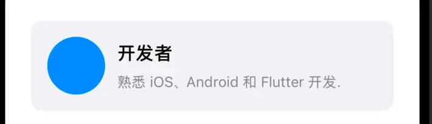

## 1.Auto Layout 底层原理

### 1.1 Auto Layout 与 frame 的区别

`frame` 是“结果导向”的（你直接告诉系统画在哪），而 `Auto Layout` 是“关系导向”的（你告诉系统它们之间是什么几何关系）。

1. **Auto Layout 核心算法引擎：Cassowary 求解器**
* 自动布局并不是简单的加减法，而是一套**线性不等式求解系统**。每一个约束（Constraint）本质上都是一个数学方程（例如：`ViewA.right + 10 <= ViewB.left`）。

2. **布局三要素**：
* **位置与尺寸**：`Leading/Trailing/Top/Bottom` 决定位置，`Width/Height` 决定尺寸。
* **优先级（Priority）**：取值范围 `1~1000`。当约束冲突时，系统会优先满足高优先级的约束，避免 Crash。
* **固有内容尺寸（Intrinsic Content Size）**：像 `UILabel`、`UIButton` 这类控件，它们自己知道内容有多大。理解它对避免拉伸错误至关重要。

### 1.2 抗压缩与抗拉伸

在用 `frame` 时，你给一个 `UILabel` 设定了宽度，如果文字太长，它就会被截断或者超出。但在 Auto Layout 中，由于控件具有 **Intrinsic Content Size（固有内容尺寸）**，系统需要面对“当空间不足或富余时，谁该变形”的灵魂拷问。

这就是新手最容易遇到“布局崩塌/约束冲突（Constraint Conflicts）”的地方：

1. **Content Compression Resistance (抗压缩优先级)**：
* **含义**：“我里面的内容很重要，你**绝对不能把我挤压变形**！”
* **场景**：比如一行文字和一个占位图标，当屏幕变窄时，图标可以被压缩，但文字绝对不能被挤压显示不全。给文字设置更高的抗压缩优先级即可。


2. **Content Hugging Priority (抗拉伸/抱紧优先级)**：
* **含义**：“我不想变大，请紧紧**抱住**我的内容，别把我拉伸得空洞！”
* **场景**：比如一个按钮和一个空白填充视图，按钮希望保持自身文字的大小（抗拉伸优先级高），而空白视图可以无限放大。

### 1.3 自动布局的渲染生命周期

你可能会好奇：既然底层是方程求解，那它最终怎么画到屏幕上？

整个渲染过程依然要遵循 UIKit 的生命周期，但多了一步“布局求解”：

1. **触发失效（Invalidation）**：当你修改了约束、或者添加了新视图时，系统并不会立刻重新计算，而是标记当前视图树需要更新（调用 `setNeedsLayout()`）。
2. **求解与计算（Layout Pass）**：在下一个 RunLoop 的渲染周期中，`layoutSubviews()` 被触发。此时 **Cassowary 求解器开始工作**，根据当前的约束方程组，计算出所有视图的精确 `frame`。
3. **应用坐标（Apply Frame）**：计算完成后，系统会把解出来的几何结果赋值给每个视图底层的 `frame` 属性，最终提交给渲染服务（Render Server）上屏。


### 1.4 代码示例

基础代码，居中对齐示例：
```swift
override func viewDidLoad() {
    super.viewDidLoad()
    view.backgroundColor = .white

    let subView = UIView()
    subView.backgroundColor = .systemRed
    // 关键点 1：必须关闭Autoresizing转AutoLayout开关（老项目历史遗留，默认是true）
    subView.translatesAutoresizingMaskIntoConstraints = false
    // 必须先添加到 super view，再添加约束，不然会 crash
    view.addSubview(subView)

    // 关键点 2：用数学方程（约束）来表达几何关系
    // 方程 1：子视图的中心X 等于 父视图的中心X
    let centerX = subView.centerXAnchor.constraint(equalTo: view.centerXAnchor)
    // 方程 2：子视图的中心Y 等于 父视图的中心Y
    let centerY = subView.centerYAnchor.constraint(equalTo: view.centerYAnchor)
    // 方程 3：子视图的宽度 等于 200
    let width = subView.widthAnchor.constraint(equalToConstant: 200)
    // 方程 4：子视图的高度 等于 100
    let height = subView.heightAnchor.constraint(equalToConstant: 100)

    // 关键点 3：激活这组约束（把方程组提交给 Cassowary 求解器）
    NSLayoutConstraint.activate([centerX, centerY, width, height])
}
```


一行显示“标题 + 详情”，但是详情内容极长，设置标题不能被挤压，详情可以被压缩：
```swift
override func viewDidLoad() {
    super.viewDidLoad()
    view.backgroundColor = .white

    // 1. 左侧标题标签
    let titleLabel = UILabel()
    titleLabel.text = "订单编号"
    titleLabel.textColor = .black
    titleLabel.translatesAutoresizingMaskIntoConstraints = false
    
    // 2. 右侧详情标签（内容极长）
    let detailLabel = UILabel()
    detailLabel.text = "20261030999988887777这串订单号非常长长长长长哈哈哈你好"
    detailLabel.textColor = .gray
    detailLabel.lineBreakMode = .byTruncatingTail
    detailLabel.translatesAutoresizingMaskIntoConstraints = false

    view.addSubview(titleLabel)
    view.addSubview(detailLabel)
    
    // --- 基础布局约束 ---
    NSLayoutConstraint.activate([
        // 标题贴着左边
        titleLabel.leadingAnchor.constraint(equalTo: view.leadingAnchor, constant: 16),
        titleLabel.centerYAnchor.constraint(equalTo: view.centerYAnchor),
        
        // 详情在标题右边，间距 8
        detailLabel.leadingAnchor.constraint(equalTo: titleLabel.trailingAnchor, constant: 8),
        // 详情右侧不能超出屏幕右边缘
        detailLabel.trailingAnchor.constraint(equalTo: view.trailingAnchor, constant: -16),
        detailLabel.centerYAnchor.constraint(equalTo: view.centerYAnchor)
    ])
    
    // --- 核心：设置抗压缩与抗拉伸优先级 ---
    // 1. 设置【标题】的抗压缩优先级为【最高 (UILayoutPriority.required)】
    // 含义：无论屏幕多窄，绝对不准把“订单编号”四个字挤压变形或打省略号！
    titleLabel.setContentCompressionResistancePriority(.required, for: .horizontal)
    
    // 2. 设置【详情】的抗压缩优先级为【较低 (默认值通常是 750)】
    // 含义：空间不够时，先压缩我（详情可以显示省略号或缩短）。
    detailLabel.setContentCompressionResistancePriority(.defaultLow, for: .horizontal)
}

// 示例2
override func viewDidLoad() {
    super.viewDidLoad()
    view.backgroundColor = .white

    // 1. 底部容器栏
    let bottomBar = UIView()
    bottomBar.backgroundColor = .systemGray6
    bottomBar.translatesAutoresizingMaskIntoConstraints = false
    view.addSubview(bottomBar)

    // 2. “确定”按钮
    let confirmButton = UIButton(type: .system)
    confirmButton.setTitle("确定", for: .normal)
    confirmButton.backgroundColor = .systemBlue
    confirmButton.setTitleColor(.white, for: .normal)
    confirmButton.layer.cornerRadius = 8
    confirmButton.translatesAutoresizingMaskIntoConstraints = false
    bottomBar.addSubview(confirmButton)

    // --- 基础布局约束 ---
    NSLayoutConstraint.activate([
        // 底部栏固定在屏幕最下方
        bottomBar.leadingAnchor.constraint(equalTo: view.leadingAnchor),
        bottomBar.trailingAnchor.constraint(equalTo: view.trailingAnchor),
        bottomBar.bottomAnchor.constraint(equalTo: view.safeAreaLayoutGuide.bottomAnchor),
        bottomBar.heightAnchor.constraint(equalToConstant: 70),
        
        // “确定”按钮的位置和尺寸
        confirmButton.trailingAnchor.constraint(equalTo: bottomBar.trailingAnchor, constant: -16),
        confirmButton.centerYAnchor.constraint(equalTo: bottomBar.centerYAnchor),
        confirmButton.heightAnchor.constraint(equalToConstant: 44),
        confirmButton.widthAnchor.constraint(equalToConstant: 88)
    ])

    // --- 核心：设置【抗拉伸优先级】（Content Hugging） ---
    // 意思：在水平方向（.horizontal）上，“确定”按钮的抗拉伸优先级设为最高（Required）。
    // 结果：系统会坚决把富余的空间全部塞给左边的区域，而“确定”按钮死死抱住自己的文字大小，绝不被拉宽！
    confirmButton.setContentHuggingPriority(.required, for: .horizontal)
    
    // 顺便设置抗压缩，防止被挤压变形
    confirmButton.setContentCompressionResistancePriority(.required, for: .horizontal)
}
```

**为什么要指定 `for: .horizontal`（水平方向）？**
因为控件在横轴和纵轴的脾气可能完全不一样：
 - 水平方向 (`.horizontal`)：文字太长时，我们关心它会不会被横向挤压
 - 垂直方向 (`.vertical`)：文字太长时，我们关心它会不会被纵向压缩。

----

## 2.SnapKit基础

`SnapKit`：用简洁的 `Swift` 语法描述 Auto Layout 约束。SnapKit 是 Apple Auto Layout 的封装。

- 源码地址： https://github.com/snapkit/snapkit
- 文档地址： https://snapkit.github.io/SnapKit/docs

**`SnapKit`核心属性对照表**

* `snp.top` / `snp.bottom` ➡️➡️ 顶部 / 底部
* `snp.left` / `snp.right` ➡️➡️ 左侧 / 右侧 (推荐使用`leading`、`trailing`属性)
* `snp.leading` / `snp.trailing` ➡️➡️ 左侧 / 右侧（自动适配 RTL 语言）
* `snp.width` / `snp.height` ➡️➡️ 宽 / 高
* `snp.centerX` / `snp.centerY` ➡️➡️ 中心点坐标
* `snp.center` ➡️➡️ 组合属性😄，包含 `x, y` 两个坐标
* `snp.size` ➡️➡️ 组合属性😄，宽度 + 高度
* `snp.edges` ➡️➡️ 组合属性😄，上下左右四条边

**三种基本约束关系**：

| API                    | 数学关系 | 说明   |
| ---------------------- | ---- | ---- |
| `equalTo`              | =    | 等于   |
| `lessThanOrEqualTo`    | ≤    | 小于等于 |
| `greaterThanOrEqualTo` | ≥    | 大于等于 |


例如：
```swift
box.snp.makeConstraints { make in
    // 宽度为 200
    make.width.equalTo(200)
    // 高度至少为 50
    make.height.greaterThanOrEqualTo(50)
    // 高度最大为 150
    make.height.lessThanOrEqualTo(150)
    // 水平居中
    make.centerX.equalToSuperview()
    // 距离顶部 100
    make.top.equalToSuperview().offset(100)
}
// 对于 UILabel、动态卡片这样的内容型控件，最大高度、最小高度约束很有用。
```

**三个数量处理**：：

| API         | 解释 | 说明   |
| ------------- | ---- | ---- |
| `offset`     |  偏移量 | 用于单个方向的正负偏移  |
| `inset`    | 内边距  | 专门用于复合属性 |
| `multipliedBy` | 比例 | 用于宽高比例约束 |
| `dividedBy` | 分数 | 用于宽高比例约束，本质是`multipliedBy`的倒数 |


防止混淆：
- `multipliedBy(0.5)`，"设置为...的 0.5 倍"，`A = B * 0.5`, **倍数关系**，适合设置宽度、高度等比例约束。
- `dividedBy(2)`，"设置为...的 1/2"，`A = B / 2`, **分数关系**，适合二等分、三等分等场景


**需要注意的点：**

```swift
// 意图：height = (width - 100) * 0.5
// 实际：height = width * 0.5 - 100  （乘法先执行了）
make.height.equalTo(superview.snp.width).offset(-100).multipliedBy(0.5)

// ⚠️ 要实现 `(width - 100) * 0.5`，在 SnapKit 中无法直接通过链式调用完成，通常需要借助 UILayoutGuide 或提前计算好数值。
```

----

#### `offset` 和 `inset`：最容易混淆的两个 API

`offset`：**在相等关系上增加偏移量** ：

```swift
// 因为偏移量的意义是等式右边增加多少，而不是自动理解你想要的内边距
make.top.equalToSuperview().offset(20)  // 顶部距离父视图顶部 20
make.left.equalToSuperview().offset(20)  // 左侧距离父视图左侧 20
make.right.equalToSuperview().offset(-20) // 右侧距离父视图右侧 20
make.bottom.equalToSuperview().offset(-20)  // 底部距离父视图底部 20
```

> 注意：
> - top、left 向内部移动通常是正数。
> - bottom、right 向内部移动通常是负数。

`inset`：**表达向内收缩的间距** ：

```swift
make.edges.equalToSuperview().inset(20)

// 等价于
make.edges.equalToSuperview().inset(UIEdgeInsets(top: 20, left: 20, bottom: 20, right: 20))

// 等价于：
make.top.equalToSuperview().offset(20)
make.left.equalToSuperview().offset(20)
make.right.equalToSuperview().offset(-20)
make.bottom.equalToSuperview().offset(-20)
```

> 推荐习惯：整体内边距使用 `inset`，某个具体属性的相对偏移使用 `offset`


代码示例：
```swift
override func viewDidLoad() {
    super.viewDidLoad()
    view.backgroundColor = .systemBackground
    
    let headerView = UIView()
    headerView.backgroundColor = .systemOrange
    view.addSubview(headerView)
    
    headerView.snp.makeConstraints { make in
        // 距离顶部安全区域向下 20 像素
        make.top.equalTo(view.safeAreaLayoutGuide.snp.top).offset(20)
        
        // 左右距离父视图边缘各缩进 16 像素（inset 自动处理负号）
        make.leading.trailing.equalToSuperview().inset(16)
        
        // 高度由宽度等比缩放：高度 = 宽度 * 0.5 (即 2:1 的横向 Banner)
        make.height.equalTo(headerView.snp.width).multipliedBy(0.5)
    }
}
```

**Frame 到 SnapKit 对照速查表**

| 以前的 Frame 思维                 | 对应的 SnapKit 思维                   |
| ---------------------------- | ------------------------------------------------ |
| `x = 20`                     | `leading.equalToSuperview().offset(20)`          |
| `y = 100`                    | `top.equalToSuperview().offset(100)`             |
| `width = 200`                | `width.equalTo(200)`                             |
| `height = 100`               | `height.equalTo(100)`                            |
| `center.x = parent.center.x` | `centerX.equalToSuperview()`                     |
| `x = other.maxX + 10`        | `leading.equalTo(other.snp.trailing).offset(10)` |
| `width = parent.width - 40`  | `leading.trailing.equalToSuperview().inset(20)`  |
| `height = width * 0.5`       | `height.equalTo(widthAnchor).multipliedBy(0.5)`  |
| `frame = parent.bounds`      | `edges.equalToSuperview()`                       |
| 修改 `frame.height`            | 更新高度约束的 constant                           |
| 手动计算 UILabel 高度              | 固有内容尺寸 + 上下约束                     |

----

对于 `UIKit`，布局采取延迟更新策略，总体分为三步:更新约束、布局、渲染，需要掌握下面几个方法：

| 方法                          | 作用        |
| ----------------------------- | ------------------ |
| `setNeedsLayout()`            | 标记需要重新布局，延迟到后续布局周期，修改 frame 会自动触发，也可以主动调用，让下一个 RunLoop 周期计算布局 |
| `layoutIfNeeded()`            | 必要时立即处理待执行的布局，此方法会立即触发 `layoutSubviews()` 的执行，调用后，可以获取计算后的 `frame` 和 `bounds`  |
| `layoutSubviews()` | 系统在布局阶段**自动调用此方法**，此时父视图的 `bounds` 已经确定，可以根据 `bounds` 来计算子视图的 `frame` 位置   |
| `setNeedsUpdateConstraints()` | 标记需要重新执行约束更新,它会在下一个更新周期触发 `updateConstraints()`  |
| `updateConstraints()` | 执行约束更新, 可以在此重写并添加、修改或移除约束  |
| `viewWillLayoutSubviews()` | UIViewController的生命周期方法，在根视图 `layoutSubviews()` 调用之前，此时布局尚未发生，`frame` 仍是旧值 |
| `viewDidLayoutSubviews()` | UIViewController的生命周期方法，在根视图 `layoutSubviews()` 调用之后，可以读到到最终的 `frame` 值 |

----


## 3.SnapKit链式语法

SnapKit 支持组合多个属性：

```swift
// 宽高都是 100
make.width.height.equalTo(100)

// 水平和垂直中心对齐
make.centerX.centerY.equalToSuperview()

// 顶部和左边间距都是 20
make.top.left.equalToSuperview().offset(20)

// 左右间距为 20
make.leading.trailing.equalToSuperview().inset(20)
```

常用快捷写法：
```swift
// 设置宽高
make.size.equalTo(CGSize(width: 100, height: 80))
// 设置宽高，更简洁
make.size.equalTo(80)

// 四条边贴住父视图
make.edges.equalToSuperview()

// 上下左右间距为 16
make.edges.equalToSuperview().inset(16)

// 水平垂直居中
make.center.equalToSuperview()

// imageView比例： 高度 = 宽度 × 9 / 16
make.height.equalTo(imageView.snp.width).multipliedBy(9.0 / 16.0)
```

## 4.常规业务布局实战

### 4.1 Safe Area

概念：
- `view.bounds`：View 的整个坐标区域。
- `view.safeAreaLayoutGuide`：UIKit 提供的安全布局参考区域。
- `view.layoutMarginsGuide`：View 的布局边距参考区域。

代码示例：
```swift
let contentView = UIView()
contentView.backgroundColor = .systemBlue
view.addSubview(contentView)

contentView.snp.makeConstraints { make in
    // 顶部紧贴安全区域顶部，底部紧贴安全区域底部
    make.top.equalTo(view.safeAreaLayoutGuide.snp.top)
    make.bottom.equalTo(view.safeAreaLayoutGuide.snp.bottom)
    // 左右紧贴安全区域左右
    make.leading.equalTo(view.safeAreaLayoutGuide.snp.leading)
    make.trailing.equalTo(view.safeAreaLayoutGuide.snp.trailing)
}

// 或者直接写：
contentView.snp.makeConstraints { make in
    make.edges.equalToSuperview().inset(view.layout.safeAreaLayoutGuide)
    // 或者
    make.edges.equalTo(view.safeAreaLayoutGuide)
}
```

对于页面背景，可以延伸到整个屏幕：
```swift
backgroundView.snp.makeConstraints { make in
    make.edges.equalToSuperview()
}
```

> 补充一个工程上的区别：Safe Area 不等于键盘安全区。键盘出现时需要额外考虑 keyboardLayoutGuide 或键盘通知。

### 4.2 两个 View 水平平分屏幕

假设我们希望两个 View 平分父视图宽度，中间间隔 10，左右各 20。

代码示例：
```swift
let leftView = UIView()
let rightView = UIView()

leftView.backgroundColor = .systemBlue
rightView.backgroundColor = .systemGreen

view.addSubview(leftView)
view.addSubview(rightView)

leftView.snp.makeConstraints { make in
    make.top.equalTo(view.safeAreaLayoutGuide).offset(20)
    make.leading.equalToSuperview().offset(20)
    make.height.equalTo(60)

    // 关键点：左右两个 View 宽度相等。加上左右边界及中间间距后，系统就能推导出两个 View 的宽度。
    make.width.equalTo(rightView.snp.width)
}

rightView.snp.makeConstraints { make in
    make.top.equalTo(leftView)
    make.leading.equalTo(leftView.snp.trailing).offset(10)
    make.trailing.equalToSuperview().offset(-20)
    make.height.equalTo(leftView)
}
```

### 4.3 UILabel 根据内容自动撑开

`UILabel` 具有 `Intrinsic Content Size`（固有内容尺寸）。需要注意的是：

- 普通 `UIView`：默认没有有用的固有内容尺寸。
- `UILabel`：通常可以根据内容计算尺寸。
- `UIImageView`：在具备图片等条件时可以提供固有内容尺寸。
- `UIButton`：可以根据标题、图片和配置等计算固有内容尺寸。

> 这是后面理解 Hugging 和 Compression Resistance 的基础。

```swift
let label = UILabel()
label.backgroundColor = .systemBlue

label.numberOfLines = 0
label.font = .systemFont(ofSize: 16)
label.text = """
这是一个多行 UILabel，它的高度不需要手动计算。
随着文字增加，Auto Layout 可以根据内容自动调整高度。
"""

view.addSubview(label)

label.snp.makeConstraints { make in
    make.top.equalTo(view.safeAreaLayoutGuide).offset(20)
    make.leading.trailing.equalToSuperview().inset(20)
}
```

### 4.4 自适应的用户信息卡片



```swift
final class UserInfoCardView: UIView {

    // MARK: - UI

    private let avatarView: UIImageView = {
        let view = UIImageView()
        view.backgroundColor = .systemBlue
        view.layer.cornerRadius = 28
        view.clipsToBounds = true
        view.contentMode = .scaleAspectFill
        return view
    }()

    private let nameLabel: UILabel = {
        let label = UILabel()
        label.font = .boldSystemFont(ofSize: 18)
        label.textColor = .label
        label.text = "开发者"
        return label
    }()

    private let bioLabel: UILabel = {
        let label = UILabel()
        label.font = .systemFont(ofSize: 14)
        label.textColor = .secondaryLabel
        label.numberOfLines = 0  // 允许多行，高度根据内容变化
        label.text = "熟悉 iOS、Android 和 Flutter 开发。"
        return label
    }()

    // MARK: - Init

    override init(frame: CGRect) {
        super.init(frame: frame)
        setupUI()
        setupConstraints()
    }

    required init?(coder: NSCoder) {
        fatalError("init(coder:) has not been implemented")
    }

    // MARK: - Setup

    private func setupUI() {
        backgroundColor = .secondarySystemBackground
        layer.cornerRadius = 12

        addSubview(avatarView)
        addSubview(nameLabel)
        addSubview(bioLabel)
    }

    private func setupConstraints() {

        // 头像约束
        avatarView.snp.makeConstraints { make in
            make.top.leading.equalToSuperview().offset(16)
            make.size.equalTo(56)

            // ⚠️ 头像底部与卡片底部至少相距 16，必须这么写，才能撑开 UserInfoCardView
            // ⚠️ 然后如果 bioLabel 内容很多，也会把 UserInfoCardView 撑开
            make.bottom.lessThanOrEqualToSuperview().offset(-16)
        }

        // 用户名约束
        nameLabel.snp.makeConstraints { make in
            make.top.equalTo(avatarView.snp.top).offset(5)
            // 位于头像右侧
            make.leading.equalTo(avatarView.snp.trailing).offset(12)
            make.trailing.equalToSuperview().offset(-16)
        }

        // 用户简介约束
        bioLabel.snp.makeConstraints { make in
            make.top.equalTo(nameLabel.snp.bottom).offset(8)
            make.leading.equalTo(nameLabel)
            make.trailing.equalToSuperview().offset(-16)
            // 内容底部距离卡片底部 16
            make.bottom.equalToSuperview().offset(-16)
        }
    }
}

// 使用的时候，不用设置高度，会根据内容自动调整高度。
// ⚠️ ⚠️ 这是 Auto Layout 的优势之一：约束可以让布局尺寸从内部内容向外传递。
let cardView = UserInfoCardView()
view.addSubview(cardView)

cardView.snp.makeConstraints { make in
    make.top.equalTo(view.safeAreaLayoutGuide.snp.top).offset(30)
    make.leading.trailing.equalToSuperview().inset(20)
}
```

### 4.5 UIScrollView 的自动布局

`ScrollView` 有两个不同的概念：
- `frameLayoutGuide`：对应 ScrollView 可视区域。
- `contentLayoutGuide`：对应 ScrollView 滚动内容区域，即 `contentSize`，会随内容变化。

对于纵向滚动：
- 内容容器的宽度通常与 `ScrollView` 可视宽度相同。
- 内容容器需要形成从顶部到底部的完整约束链。
- 内容实际高度决定可滚动范围。


以下是一个可以自动撑开内容高度的例子。

```swift
final class ScrollDemoViewController: UIViewController {

    private let scrollView = UIScrollView()
    private let contentView = UIView()

    private let descriptionLabel: UILabel = {
        let label = UILabel()
        label.numberOfLines = 0
        label.font = .systemFont(ofSize: 16)
        label.text = String(
            repeating: "这是一个自动布局的滚动页面。\n",
            count: 130
        )
        return label
    }()

    override func viewDidLoad() {
        super.viewDidLoad()
        view.backgroundColor = .systemBackground

        scrollView.layer.borderWidth = 2
        scrollView.layer.borderColor = UIColor.red.cgColor
        view.addSubview(scrollView)
        scrollView.addSubview(contentView)
        contentView.addSubview(descriptionLabel)

        setupConstraints()
    }

    private func setupConstraints() {
        // ScrollView 占据整个安全区域
        scrollView.snp.makeConstraints { make in
            make.edges.equalTo(view.safeAreaLayoutGuide).inset(30)
        }

        // 内容容器关联 ScrollView 的内容区域
        contentView.snp.makeConstraints { make in
            // ⚠️ 四条边决定内容区域边界
            make.edges.equalTo(scrollView.contentLayoutGuide)
            // ⚠️ 固定为可视区域的宽度，避免横向滚动
            make.width.equalTo(scrollView.frameLayoutGuide)
        }

        // 多行文字决定内容容器的高度
        descriptionLabel.snp.makeConstraints { make in
            make.top.equalToSuperview().offset(20)
            make.leading.trailing.equalToSuperview().inset(20)
            make.bottom.equalToSuperview().offset(-20)
        }
    }
}
```

## 5.动态布局、约束更新与动画

### 5.1 更新约束

这里涉及 SnapKit 最重要的三个方法。

`makeConstraints`、`updateConstraints`、`remakeConstraints` 的区别：

| 方法                  | 行为                         | 使用场景        |
| ------------------- | -------------------------- | ----------- |
| `makeConstraints`   | 新建并激活约束                    | 初次创建布局      |
| `updateConstraints` | 匹配已有约束并更新常量等               | 修改间距、宽高常量   |
| `remakeConstraints` | 移除该对象既有的 SnapKit 管理约束并重新创建 | 约束关系发生结构性变化 |


例如：
```swift
box.snp.makeConstraints { make in
    make.width.height.equalTo(100)
    make.center.equalToSuperview()
}

// 后来只是想改变宽度：
box.snp.updateConstraints { make in
    make.width.equalTo(200)
}

// 但如果你希望从「居中」改成「靠左上角」，不要使用 updateConstraints 去改变约束参照属性：
box.snp.remakeConstraints { make in
    make.top.equalTo(view.safeAreaLayoutGuide).offset(20)
    make.leading.equalToSuperview().offset(20)
    make.size.equalTo(100)
}
```

> 注意：`remakeConstraints` 会处理目标对象之前由 SnapKit 记录的约束，但不会替你清理所有通过原生 NSLayoutConstraint 或其他布局系统创建的约束。

### 5.2 保存约束引用

相比每次调用 `updateConstraints`，我更推荐对于需要频繁修改的单条约束，直接保存其引用。
```swift
private var heightConstraint: Constraint?

// 1.创建时
box.snp.makeConstraints { make in
    make.top.equalTo(view.safeAreaLayoutGuide).offset(20)
    make.leading.trailing.equalToSuperview().inset(20)

    // 保存高度约束
    heightConstraint = make.height.equalTo(100).constraint
}

// 2.后续修改时
// 将高度从 100 修改为 200
heightConstraint?.updateOffset(200)
```

**约束引用其他操作**
```swift
// 更新偏移量
heightConstraint?.updateOffset(150)

// 停用约束
heightConstraint?.deactivate()

// 重新激活约束
heightConstraint?.activate()
```

### 5.3 点击展开与收起动画

下面实现一个蓝色容器，点击按钮后高度从 100 变成 240，再次点击恢复。

```swift
final class ExpandDemoViewController: UIViewController {
    private let boxView = UIView()
    private let toggleButton = UIButton(type: .system)

    // 保存需要动态修改的高度约束
    private var boxHeightConstraint: Constraint?

    private var isExpanded = false

    override func viewDidLoad() {
        super.viewDidLoad()

        view.backgroundColor = .systemBackground

        boxView.backgroundColor = .systemBlue
        boxView.layer.cornerRadius = 12

        toggleButton.setTitle("展开 / 收起", for: .normal)
        toggleButton.addTarget(self, action: #selector(toggleAction), for: .touchUpInside)

        view.addSubview(boxView)
        view.addSubview(toggleButton)

        setupConstraints()
    }

    private func setupConstraints() {
        boxView.snp.makeConstraints { make in
            make.top.equalTo(view.safeAreaLayoutGuide).offset(40)
            make.leading.trailing.equalToSuperview().inset(20)

            // 初始高度为 100，并保存约束
            boxHeightConstraint = make.height.equalTo(100).constraint
        }

        toggleButton.snp.makeConstraints { make in
            make.top.equalTo(boxView.snp.bottom).offset(20)
            make.centerX.equalToSuperview()
        }
    }

    @objc private func toggleAction() {
        isExpanded.toggle()

        // 计算新的目标高度
        let newHeight: CGFloat = isExpanded ? 240 : 100

        // 确保旧的布局状态已经处理
        view.layoutIfNeeded()

        // 更新约束常量
        boxHeightConstraint?.update(offset: newHeight)

        // 让 UIKit 动画执行新旧布局之间的变化
        UIView.animate(withDuration: 0.35, delay: 0, options: [.curveEaseInOut]) {
            self.view.layoutIfNeeded()
        }
    }
}
```

**为什么动画使用 `view.layoutIfNeeded()`？**
- 因为约束会影响整个局部布局关系，例如 Box 高度变化后，位于它下方的 Button 也需要同步移动。
- 调用共同的布局祖先视图的 `layoutIfNeeded()`，可以使这些关联变化在同一次动画中完成。


### 5.4 什么时候需要 override updateConstraints()？

这里有一个常见误解：使用 `SnapKit` 更新约束，必须重写 `UIView` 的 `updateConstraints()`。

并不是。

Apple 当前的建议是，通常直接在触发状态变化的位置修改约束更简单，只有需要批量处理多次冗余更新时，才考虑重写 `updateConstraints()`

所以你的项目通常可以采用：
```swift
func updateLoadingState(isLoading: Bool) {
    // 直接修改某个约束
    heightConstraint?.updateOffset(isLoading ? 80 : 50)

    // 标记需要布局
    setNeedsLayout()
}
```

> 如果确实需要重写，应由状态驱动更新，避免无条件反复创建约束，也不要在方法内部调用 `setNeedsUpdateConstraints()` 引发循环。

## 6.高级 Auto Layout 与性能优化

### 6.1 约束优先级：priority

Auto Layout 允许约束带有优先级。范围为 1～1000，数值越大，越希望系统优先满足。`1000` 表示 `Required`（必须满足）。

| Priority | 常见用途          |
| -------- | ------------- |
| 1000     | 必须遵守的布局关系     |
| 999      | 接近强制但允许极端情况退让 |
| 750      | 较高优先级         |
| 500      | 中等优先级         |
| 250      | 较低优先级         |

例如：

```swift
box.snp.makeConstraints { make in
    // 优先希望宽度为 300
    make.width.equalTo(300).priority(750)

    // 宽度不能超过父视图可用宽度
    make.width.lessThanOrEqualToSuperview().offset(-40)

    make.height.equalTo(100)
    make.center.equalToSuperview()
}
```

假设父视图宽度只有 320，那么最大宽度约束要求: `width <= 320 - 40 = 280`

固定宽度 300 的约束优先级只有 750，因此系统可以放弃它，采用宽度 280。

SnapKit 还提供快捷写法：
```swift
make.width.equalTo(300).priority(.high)
make.height.equalTo(100).priority(.low)
make.centerX.equalToSuperview().priority(.required)
```

### 6.2 Content Hugging 与 Compression Resistance

这是 Auto Layout 中最容易混淆，也是 UILabel 布局最重要的概念。二者都围绕控件的固有内容尺寸（Intrinsic Content Size）：
- Content Hugging：控件不愿意被拉得比固有尺寸更大，Hugging 优先级越高，越不愿意被拉长。
- Compression Resistance：控件不愿意被压得比固有尺寸更小。Compression 优先级越高，越不愿意被压小。

实际案例：左边用户名，右边按钮。

假设容器宽度有限，左边 UILabel 显示用户名，右边 UIButton 显示「关注」。

我们希望：

- 关注按钮尽量保持完整。
- 用户名过长时允许截断。
- 两个控件之间保持 12pt。


```swift
let nameLabel = UILabel()
nameLabel.numberOfLines = 1
nameLabel.lineBreakMode = .byTruncatingTail

let followButton = UIButton(type: .system)
followButton.setTitle("关注", for: .normal)

// 用户名允许水平压缩
nameLabel.setContentCompressionResistancePriority(.defaultLow, for: .horizontal)
// 按钮尽量保持自身内容尺寸
followButton.setContentCompressionResistancePriority(.required, for: .horizontal)
// 让按钮倾向于保持固有宽度
followButton.setContentHuggingPriority(.defaultHigh, for: .horizontal)

// 省略其他约束代码。 当容器空间不足时，用户名会优先被压缩。
```

> 需要注意：Hugging 和 Compression Resistance 本身也是以优先级形式表达的布局约束，并不是一个独立于 Auto Layout 的尺寸机制。


### 6.3 UITableViewCell 自适应高度

Auto Layout 可以让 Cell 根据内部内容计算高度。

首先设置：

```swift
tableView.rowHeight = UITableView.automaticDimension
tableView.estimatedRowHeight = 100  // 预估的高度
```

Cell 实现：

```swift
final class MessageCell: UITableViewCell {

    static let reuseIdentifier = "MessageCell"

    private let messageLabel: UILabel = {
        let label = UILabel()
        label.numberOfLines = 0
        label.font = .systemFont(ofSize: 16)
        label.textColor = .label
        return label
    }()

    override init(style: UITableViewCell.CellStyle,
                  reuseIdentifier: String?) {

        super.init(style: style, reuseIdentifier: reuseIdentifier)

        contentView.addSubview(messageLabel)

        // ⚠️ 必须建立完整的上下约束链
        messageLabel.snp.makeConstraints { make in
            make.top.equalToSuperview().offset(12)
            make.leading.trailing.equalToSuperview().inset(16)
            make.bottom.equalToSuperview().offset(-12)
        }
    }
}
```

> 对于复杂 Cell，同样需要保证从 contentView 顶部到底部有可求解的完整布局关系。

### 6.4 Auto Layout 常见报错与排查

| 现象         | 常见原因              | 解决方向         |
| ------------------- | ----------------- | ------------------------- |
| View 不显示     | 约束不足、尺寸为零         | 检查宽高及约束链     |
| Unable to simultaneously satisfy constraints | 约束互相矛盾    | 排查重复约束和优先级   |
| UILabel 被意外截断   | 压缩优先级、宽度限制   | 检查 Compression Resistance |
| ScrollView 不滚动 | 内容高度没有形成完整约束链     | 检查 contentLayoutGuide  |
| 修改约束没有动画    | 没有触发布局过渡   | 检查 layoutIfNeeded 调用位置    |
| 更新约束后崩溃     | update 无法匹配对应已有约束 | 检查约束属性和参照对象   |
| 布局随设备变化错乱    | 使用固定尺寸或错误区域    | 检查 Safe Area 和弹性约束  |


### 6.5 SnapKit 的 labeled 方法

你可以为关键约束添加调试标识：
```swift
box.snp.makeConstraints { make in

    make.top.equalToSuperview()
        .offset(20)
        .labeled("box_top")

    make.height.equalTo(100)
        .labeled("box_height")
}
```

当 Auto Layout 报告约束冲突时，相关标识能帮助你定位来源。


