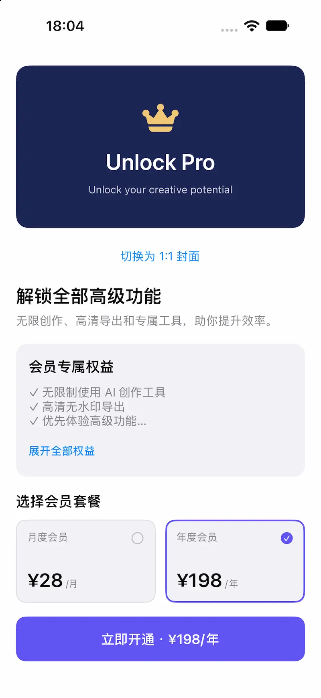
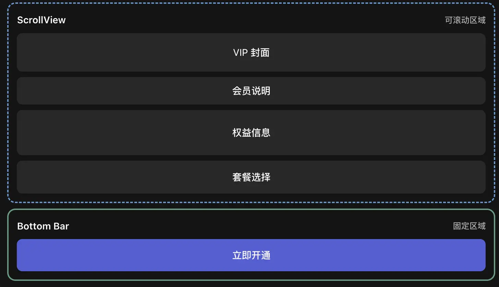
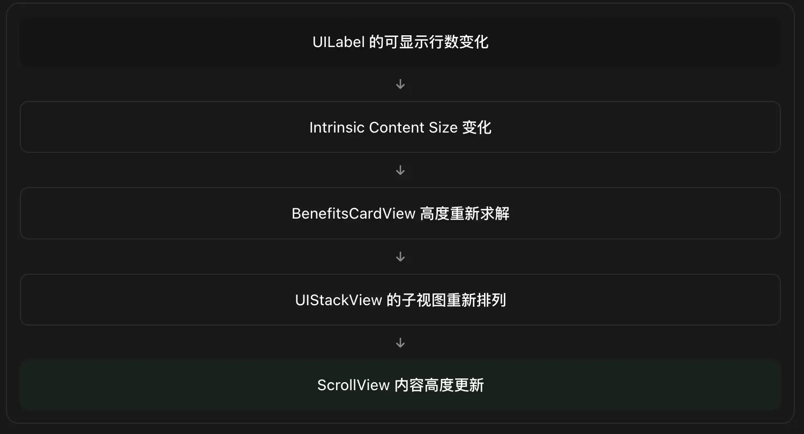

## 一、最终界面

综合实战：一个商业级 VIP 订阅页面

> 技术栈：Swift + UIKit + SnapKit 6.0.0，最低 iOS 15.0



## 二、这个 Demo 涉及哪些 SnapKit 知识？

| 功能            | SnapKit 核心知识                |
| ------------- | --------------------------- |
| VIP 顶部封面      | 宽高比例约束 `multipliedBy`       |
| 16:9 与 1:1 切换 | `remakeConstraints`         |
| 会员权益动态展开      | Intrinsic Content Size、布局动画 |
| 月度 / 年度套餐     | 等宽布局、Compression Resistance |
| 底部固定购买栏       | Safe Area、视图层级              |
| 购买按钮高度变化      | `updateConstraints`         |
| 底部和滚动区域避让     | 约束链与 UIScrollView           |
| 自动布局动画        | `layoutIfNeeded`            |
| 适配不同屏幕尺寸      | 相对布局、不写死屏幕宽度                |
| 工程模块拆分        | UIView 子类、状态管理、单向 UI 更新     |

这里我们特意采用三种不同的约束更新方案，帮助你理解各自的适用场景。

- `updateConstraints`：套餐变化后只更新购买按钮的高度常量。
- `remakeConstraints`：封面切换比例，重建倍率不同的高度约束。
- 不修改约束：会员权益展开时，只修改标签内容状态，让固有内容尺寸自动推动布局变化。

这是学习 Auto Layout 非常重要的三个层次。

## 三、项目架构设计

这个 Demo 采用轻量的 UIKit 组件化结构，不引入不必要的 MVVM 架构。
```
ProMembershipDemo/
│
├── MembershipViewController.swift
│   ├── 页面结构
│   ├── 约束创建与更新
│   ├── 业务交互
│   └── 动画协调
│
├── MembershipHeroView.swift
│   ├── 会员封面 UI
│   └── 封面比例切换
│
├── BenefitsCardView.swift
│   ├── 权益信息
│   └── 展开 / 收起
│
└── MembershipPlanView.swift
    ├── 套餐数据展示
    └── 选中状态
```

这样分层的原因是：ViewController 负责协调页面状态，UIView 子类负责展示和局部交互，而不是在一个 500 行的控制器里直接操作全部 UI 属性。

## 四、代码实现

### 4.1 MembershipHeroView\.swift

封面组件负责内容展示。宽高比交给父控制器管理，因为父控制器需要决定整个页面采用哪种展示模式。

```swift
import UIKit
import SnapKit

final class MembershipHeroView: UIView {

    private let crownView: UIImageView = {
        let config = UIImage.SymbolConfiguration(
            pointSize: 52,
            weight: .medium
        )

        let view = UIImageView(
            image: UIImage(systemName: "crown.fill",
                           withConfiguration: config)
        )
        view.tintColor = UIColor(
            red: 0.94, green: 0.78, blue: 0.46, alpha: 1
        )
        view.contentMode = .scaleAspectFit
        return view
    }()

    private let titleLabel: UILabel = {
        let label = UILabel()
        label.text = "Unlock Pro"
        label.font = .boldSystemFont(ofSize: 28)
        label.textColor = .white
        label.textAlignment = .center
        return label
    }()

    private let subtitleLabel: UILabel = {
        let label = UILabel()
        label.text = "Unlock your creative potential"
        label.font = .systemFont(ofSize: 13)
        label.textColor = .white.withAlphaComponent(0.8)
        label.textAlignment = .center
        label.numberOfLines = 0
        return label
    }()

    override init(frame: CGRect) {
        super.init(frame: frame)

        backgroundColor = UIColor(
            red: 0.11, green: 0.15, blue: 0.33, alpha: 1
        )

        layer.cornerRadius = 16
        clipsToBounds = true

        let stack = UIStackView(
            arrangedSubviews: [
                crownView,
                titleLabel,
                subtitleLabel
            ]
        )

        stack.axis = .vertical
        stack.alignment = .center
        stack.spacing = 10

        addSubview(stack)

        crownView.snp.makeConstraints { make in
            make.size.equalTo(54)
        }

        stack.snp.makeConstraints { make in
            // 封面内所有内容居中
            make.center.equalToSuperview()

            // 不允许超出封面左右边界
            make.leading.greaterThanOrEqualToSuperview()
                .offset(12)
            make.trailing.lessThanOrEqualToSuperview()
                .offset(-12)

            // 避免紧凑尺寸下内容越界
            make.top.greaterThanOrEqualToSuperview()
                .offset(12)
            make.bottom.lessThanOrEqualToSuperview()
                .offset(-12)
        }
    }

    required init?(coder: NSCoder) {
        fatalError("init(coder:) has not been implemented")
    }
}

```

这里我们使用 UIStackView 负责内部的竖向排列，SnapKit 负责它相对于父视图的定位。

这是商业 App 中值得采用的组合：重复排列交给 UIStackView，复杂尺寸与相对位置交给 SnapKit。

这里的 `greaterThanOrEqualTo` 和 `lessThanOrEqualTo` 也是实际业务中有意义的不等式约束：它们要求内容保持在封面内部，而不是强制固定四边间距。

### 4.2 BenefitsCardView\.swift

接下来实现会员权益卡片。

这个组件要支持：

- 多行文本。
- 展开、收起。
- 内容自动推动卡片高度。
- 让控制器知道用户触发了状态变化。

```swift
import UIKit
import SnapKit

final class BenefitsCardView: UIView {

    // 由外部控制器负责动画协调
    var onToggle: (() -> Void)?

    private let titleLabel: UILabel = {
        let label = UILabel()
        label.text = "会员专属权益"
        label.font = .boldSystemFont(ofSize: 18)
        label.textColor = .label
        return label
    }()

    private let detailsLabel: UILabel = {
        let label = UILabel()
        label.font = .systemFont(ofSize: 15)
        label.textColor = .secondaryLabel
        label.numberOfLines = 3
        label.text = """
        ✓ 无限制使用 AI 创作工具
        ✓ 高清无水印导出
        ✓ 优先体验高级功能
        ✓ 专属会员模板
        ✓ 云端同步与更多专属权益
        """
        return label
    }()

    private let toggleButton: UIButton = {
        let button = UIButton(type: .system)
        button.setTitle("展开全部权益", for: .normal)
        button.titleLabel?.font = .systemFont(
            ofSize: 14,
            weight: .medium
        )
        return button
    }()

    private(set) var isExpanded = false

    override init(frame: CGRect) {
        super.init(frame: frame)

        backgroundColor = .secondarySystemBackground
        layer.cornerRadius = 14

        addSubview(titleLabel)
        addSubview(detailsLabel)
        addSubview(toggleButton)

        titleLabel.snp.makeConstraints { make in
            make.top.equalToSuperview().offset(18)
            make.leading.trailing.equalToSuperview().inset(16)
        }

        detailsLabel.snp.makeConstraints { make in
            make.top.equalTo(titleLabel.snp.bottom).offset(12)
            make.leading.trailing.equalToSuperview().inset(16)
        }

        toggleButton.snp.makeConstraints { make in
            make.top.equalTo(detailsLabel.snp.bottom).offset(14)
            make.leading.equalToSuperview().offset(16)

            // 建立到底部的完整约束链
            make.bottom.equalToSuperview().offset(-18)
        }

        toggleButton.addTarget(
            self,
            action: #selector(toggleTapped),
            for: .touchUpInside
        )
    }

    required init?(coder: NSCoder) {
        fatalError("init(coder:) has not been implemented")
    }

    @objc private func toggleTapped() {
        onToggle?()
    }

    // 只更新 UI 状态，不在这里启动动画
    func setExpanded(_ expanded: Bool) {
        isExpanded = expanded

        detailsLabel.numberOfLines = expanded ? 0 : 3

        let title = expanded ? "收起权益" : "展开全部权益"
        toggleButton.setTitle(title, for: .normal)
    }
}
```

**为什么没有给卡片设置`height`？**

因为布局链已经完整：

```
卡片顶部
    ↓ 18
titleLabel
    ↓ 12
detailsLabel
    ↓ 14
toggleButton
    ↓ 18
卡片底部
```

当 `detailsLabel.numberOfLines` 从 3 变成 0 时，UILabel 的固有内容高度发生改变，系统会重新计算整张卡片的高度。

这就是所谓的 Self-Sizing（内容驱动尺寸）。

这里完全不需要：

```swift
detailsLabel.sizeToFit()
```

也不需要：

```swift
let height = text.boundingRect(...)
```

对于你之前习惯使用 Frame 的开发方式，这是最值得体验的地方。

### 4.3 MembershipPlanView\.swift

套餐卡片组件。

这里涉及到两个重要的 Auto Layout 问题：

1. 两张套餐卡片的宽度如何相同？
2. 套餐价格比较长时如何避免文字意外压缩？

第一点由父控制器的 UIStackView 处理；第二点由组件内部合理的文本约束处理。

```swift
import UIKit
import SnapKit

enum MembershipPlan: CaseIterable {
    case monthly
    case annual

    var title: String {
        switch self {
        case .monthly: return "月度会员"
        case .annual: return "年度会员"
        }
    }

    var priceText: String {
        switch self {
        case .monthly: return "¥28"
        case .annual: return "¥198"
        }
    }

    var periodText: String {
        switch self {
        case .monthly: return "/月"
        case .annual: return "/年"
        }
    }
}

final class MembershipPlanView: UIControl {

    let plan: MembershipPlan

    private let titleLabel = UILabel()
    private let priceLabel = UILabel()
    private let periodLabel = UILabel()
    private let checkView = UIImageView()

    init(plan: MembershipPlan) {
        self.plan = plan
        super.init(frame: .zero)

        setupUI()
        setupConstraints()
        setSelected(false)
    }

    required init?(coder: NSCoder) {
        fatalError("init(coder:) has not been implemented")
    }

    private func setupUI() {
        backgroundColor = .secondarySystemBackground
        layer.cornerRadius = 12
        layer.borderWidth = 1

        titleLabel.text = plan.title
        titleLabel.font = .systemFont(ofSize: 13)
        titleLabel.textColor = .secondaryLabel

        priceLabel.text = plan.priceText
        priceLabel.font = .boldSystemFont(ofSize: 24)
        priceLabel.textColor = .label

        periodLabel.text = plan.periodText
        periodLabel.font = .systemFont(ofSize: 12)
        periodLabel.textColor = .secondaryLabel

        checkView.contentMode = .scaleAspectFit

        // 价格尽量不被截断
        priceLabel.setContentCompressionResistancePriority(
            .defaultHigh,
            for: .horizontal
        )

        // 单位文字相对更容易压缩
        periodLabel.setContentCompressionResistancePriority(
            .defaultLow,
            for: .horizontal
        )

        [titleLabel, priceLabel, periodLabel, checkView].forEach {
            addSubview($0)
        }
    }

    private func setupConstraints() {
        titleLabel.snp.makeConstraints { make in
            make.top.leading.equalToSuperview().offset(14)

            // 与右侧选择图标保持间距
            make.trailing.lessThanOrEqualTo(
                checkView.snp.leading
            ).offset(-6)
        }

        checkView.snp.makeConstraints { make in
            make.top.trailing.equalToSuperview().inset(14)
            make.size.equalTo(18)
        }

        priceLabel.snp.makeConstraints { make in
            make.leading.equalToSuperview().offset(14)
            make.bottom.equalToSuperview().offset(-14)
        }

        periodLabel.snp.makeConstraints { make in
            make.leading.equalTo(priceLabel.snp.trailing).offset(3)
            make.trailing.lessThanOrEqualToSuperview().offset(-8)
            make.lastBaseline.equalTo(priceLabel.snp.lastBaseline)
        }
    }

    func setSelected(_ selected: Bool) {
        isSelected = selected

        layer.borderWidth = selected ? 2 : 1
        layer.borderColor = selected
            ? UIColor.systemIndigo.cgColor
            : UIColor.separator.cgColor

        checkView.image = UIImage(
            systemName: selected
                ? "checkmark.circle.fill"
                : "circle"
        )

        checkView.tintColor = selected
            ? .systemIndigo
            : .tertiaryLabel
    }
}

```

这里值得注意：

```swift
make.lastBaseline.equalTo(priceLabel.snp.lastBaseline)
```

这是一个比 `centerY` 更精细的布局方法。

当两个 UILabel 的字体大小不同时，垂直中心对齐不一定让文字视觉上位于同一水平线，而基线对齐可以使文本排版更加自然。

真实商业界面中，价格和单位的组合经常采用这种做法。

### 4.4 MembershipViewController.swift

这是整个 Demo 最核心的文件。

我们在这里把封面、权益、套餐、购买栏组合起来，并完成三种不同的动态布局处理。

```swift
import UIKit
import SnapKit

final class MembershipViewController: UIViewController {

    // MARK: - State

    private var selectedPlan: MembershipPlan = .annual
    private var isSquarePreview = false

    // MARK: - Main Views

    private let scrollView = UIScrollView()
    private let contentView = UIView()

    private let contentStack: UIStackView = {
        let stack = UIStackView()
        stack.axis = .vertical
        stack.alignment = .fill
        stack.spacing = 20
        return stack
    }()

    private let heroView = MembershipHeroView()
    private let benefitsView = BenefitsCardView()

    private let previewButton: UIButton = {
        let button = UIButton(type: .system)
        button.setTitle("切换为 1:1 封面", for: .normal)
        return button
    }()

    private let titleLabel: UILabel = {
        let label = UILabel()
        label.text = "解锁全部高级功能"
        label.font = .boldSystemFont(ofSize: 24)
        label.numberOfLines = 0
        return label
    }()

    private let subtitleLabel: UILabel = {
        let label = UILabel()
        label.text = "无限创作、高清导出和专属工具，助你提升效率。"
        label.font = .systemFont(ofSize: 15)
        label.textColor = .secondaryLabel
        label.numberOfLines = 0
        return label
    }()

    private let planTitleLabel: UILabel = {
        let label = UILabel()
        label.text = "选择会员套餐"
        label.font = .boldSystemFont(ofSize: 18)
        return label
    }()

    private lazy var monthlyView = MembershipPlanView(plan: .monthly)
    private lazy var annualView = MembershipPlanView(plan: .annual)

    private let planStack: UIStackView = {
        let stack = UIStackView()
        stack.axis = .horizontal
        stack.distribution = .fillEqually
        stack.alignment = .fill
        stack.spacing = 12
        return stack
    }()

    // MARK: - Bottom Bar

    private let bottomBar: UIView = {
        let view = UIView()
        view.backgroundColor = .systemBackground
        return view
    }()

    private let purchaseButton: UIButton = {
        let button = UIButton(type: .system)
        button.backgroundColor = .systemIndigo
        button.tintColor = .white
        button.titleLabel?.font = .boldSystemFont(ofSize: 17)
        button.layer.cornerRadius = 12
        return button
    }()

    // 保存需要频繁更新的约束
    private var purchaseHeightConstraint: Constraint?

    // MARK: - Lifecycle

    override func viewDidLoad() {
        super.viewDidLoad()

        view.backgroundColor = .systemBackground
        title = "Pro Membership"

        setupUI()
        setupConstraints()
        setupActions()
        renderState()
    }

    // MARK: - UI

    private func setupUI() {

        scrollView.alwaysBounceVertical = true
        scrollView.showsVerticalScrollIndicator = false
        scrollView.contentInsetAdjustmentBehavior = .never

        // 滚动内容与底部购买栏是兄弟视图
        view.addSubview(scrollView)
        view.addSubview(bottomBar)

        scrollView.addSubview(contentView)
        contentView.addSubview(contentStack)

        bottomBar.addSubview(purchaseButton)

        // 套餐横向布局
        planStack.addArrangedSubview(monthlyView)
        planStack.addArrangedSubview(annualView)

        // 页面内容按顺序加入 StackView
        [
            heroView,
            previewButton,
            titleLabel,
            subtitleLabel,
            benefitsView,
            planTitleLabel,
            planStack
        ].forEach {
            contentStack.addArrangedSubview($0)
        }

        // 可选：微调局部控件之间的距离
        contentStack.setCustomSpacing(8, after: titleLabel)
        contentStack.setCustomSpacing(12, after: planTitleLabel)

        // 点击区域整体响应套餐选择
        monthlyView.addTarget(
            self,
            action: #selector(monthlyTapped),
            for: .touchUpInside
        )

        annualView.addTarget(
            self,
            action: #selector(annualTapped),
            for: .touchUpInside
        )
    }

    // MARK: - Constraints

    private func setupConstraints() {

        // 1. 固定购买栏
        bottomBar.snp.makeConstraints { make in
            make.leading.trailing.bottom.equalToSuperview()
        }

        purchaseButton.snp.makeConstraints { make in
            make.leading.trailing.equalToSuperview().inset(20)

            // 购买按钮顶部距离购买栏顶部 12
            make.top.equalToSuperview().offset(12)

            // 底部始终位于 Safe Area 之上
            make.bottom.equalTo(view.safeAreaLayoutGuide.snp.bottom)
                .offset(-12)

            // 保存高度约束：后续使用 updateConstraints
            purchaseHeightConstraint = make.height.equalTo(56).constraint
        }

        // 2. 滚动区域
        scrollView.snp.makeConstraints { make in
            make.top.equalTo(view.safeAreaLayoutGuide.snp.top)
            make.leading.trailing.equalToSuperview()

            // 滚动区域结束于购买栏上方
            make.bottom.equalTo(bottomBar.snp.top)
        }

        // 3. ScrollView 内容容器
        contentView.snp.makeConstraints { make in

            // 对应滚动内容区域
            make.edges.equalTo(scrollView.contentLayoutGuide)

            // 宽度固定等于可视区域宽度
            make.width.equalTo(scrollView.frameLayoutGuide)
        }

        // 4. 垂直内容栈
        contentStack.snp.makeConstraints { make in
            make.top.equalToSuperview().offset(20)
            make.leading.trailing.equalToSuperview().inset(20)
            make.bottom.equalToSuperview().offset(-24)
        }

        // 5. 封面比例：16:9
        heroView.snp.makeConstraints { make in

            // 高度 = 宽度 × 9/16
            make.height.equalTo(heroView.snp.width)
                .multipliedBy(9.0 / 16.0)
        }

        // 6. 两个套餐组件的固定最小展示高度
        planStack.snp.makeConstraints { make in
            make.height.greaterThanOrEqualTo(104)
        }

        // 套餐内容的纵向尺寸由父级容器保证
        monthlyView.snp.makeConstraints { make in
            make.height.greaterThanOrEqualTo(104)
        }

        annualView.snp.makeConstraints { make in
            make.height.greaterThanOrEqualTo(104)
        }
    }

    // MARK: - Actions

    private func setupActions() {

        previewButton.addTarget(
            self,
            action: #selector(previewTapped),
            for: .touchUpInside
        )

        purchaseButton.addTarget(
            self,
            action: #selector(purchaseTapped),
            for: .touchUpInside
        )

        // 使用 weak self，避免闭包潜在的循环引用
        benefitsView.onToggle = { [weak self] in
            self?.toggleBenefits()
        }
    }

    // MARK: - Business State

    private func renderState() {

        monthlyView.setSelected(selectedPlan == .monthly)
        annualView.setSelected(selectedPlan == .annual)

        let price = selectedPlan.priceText
        let period = selectedPlan.periodText

        purchaseButton.setTitle(
            "立即开通 · \(price)\(period)",
            for: .normal
        )

        // 购买按钮高度只需要更新常量
        let buttonHeight: CGFloat =
            selectedPlan == .annual ? 56 : 50

        purchaseHeightConstraint?.update(offset: buttonHeight)
    }

    // MARK: - 交互一：套餐切换

    @objc private func monthlyTapped() {
        selectPlan(.monthly)
    }

    @objc private func annualTapped() {
        selectPlan(.annual)
    }

    private func selectPlan(_ plan: MembershipPlan) {

        guard selectedPlan != plan else { return }

        // 先提交旧布局
        view.layoutIfNeeded()

        selectedPlan = plan

        // renderState 会修改按钮的高度约束
        renderState()

        // 底部购买栏随高度变化做动画
        UIView.animate(
            withDuration: 0.3,
            delay: 0,
            options: [.curveEaseInOut]
        ) {
            self.view.layoutIfNeeded()
        }
    }

    // MARK: - 交互二：比例切换

    @objc private func previewTapped() {

        view.layoutIfNeeded()

        isSquarePreview.toggle()

        let ratio: CGFloat = isSquarePreview
            ? 1.0
            : 9.0 / 16.0

        // 倍率变化不能当作普通常量更新
        // 所以重新创建封面的比例约束
        heroView.snp.remakeConstraints { make in
            make.height.equalTo(heroView.snp.width)
                .multipliedBy(ratio)
        }

        previewButton.setTitle(
            isSquarePreview
                ? "切换为 16:9 封面"
                : "切换为 1:1 封面",
            for: .normal
        )

        // 封面高度变化会推动下方所有内容
        UIView.animate(
            withDuration: 0.35,
            delay: 0,
            options: [.curveEaseInOut]
        ) {
            self.view.layoutIfNeeded()
        }
    }

    // MARK: - 交互三：权益展开

    private func toggleBenefits() {

        view.layoutIfNeeded()

        let expanded = !benefitsView.isExpanded

        // 只改变 UILabel 内容展示状态
        benefitsView.setExpanded(expanded)

        // 让 Auto Layout 自动计算新高度
        UIView.animate(
            withDuration: 0.3,
            delay: 0,
            options: [.curveEaseInOut]
        ) {
            self.view.layoutIfNeeded()
        }
    }

    // MARK: - Purchase

    @objc private func purchaseTapped() {

        // 这里不实现真实支付，只展示选中状态
        let alert = UIAlertController(
            title: "演示模式",
            message: "当前选择：\(selectedPlan.title)，价格 \(selectedPlan.priceText)。",
            preferredStyle: .alert
        )

        alert.addAction(
            UIAlertAction(title: "确定", style: .default)
        )

        present(alert, animated: true)
    }
}
```

## 五、逐一拆解关键布局原理

### 5.1 为什么底部购买栏不放进 ScrollView？

这是最重要的架构决策之一。


核心约束关系：

```swift
scrollView.snp.makeConstraints { make in
    make.bottom.equalTo(bottomBar.snp.top)
}
```

这意味着购买栏始终固定，滚动区域在购买栏上方结束。

相比把整个页面都塞进 ScrollView，再手动调整 `contentInset.bottom` 来避让悬浮按钮，这种实现更简单，也更容易维护。

### 5.2 为什么比例切换必须使用 remakeConstraints？

原始比例：

```swift
make.height.equalTo(heroView.snp.width)
    .multipliedBy(9.0 / 16.0)
```

对应：`height = width * 9/16`

切换为 1:1：

对应：`height = width`

这是这不是改变常量，而是改变乘数。

普通的 `updateConstraints` 适合更新匹配约束的常量，但不能直接把已有 NSLayoutConstraint 的 multiplier 改成另一个值。

因此：

```swift
heroView.snp.remakeConstraints { make in
    make.height.equalTo(heroView.snp.width)
        .multipliedBy(1.0)
}
```

这是合理的选择。

另外，本示例中 HeroView 的 `remakeConstraints` 只涉及控制器为它安装的比例约束。HeroView 内部子视图的约束属于不同布局对象，不会因为重建 HeroView 本身的约束就一并删除。

### 5.3 updateConstraints 和 updateOffset 的使用区别

本示例使用了：

```swift
purchaseHeightConstraint?.update(offset: buttonHeight)
```

SnapKit 同样提供：

```swift
purchaseButton.snp.updateConstraints { make in
    make.height.equalTo(50)
}
```

两者都可以完成这种常量修改。

对于单条需要频繁修改的约束，我更推荐保存约束引用，因为更明确。


### 5.4 为什么展开权益不需要 updateConstraints？

因为高度由内容决定：

```swift
detailsLabel.numberOfLines = expanded ? 0 : 3
```

这里发生的变化是：


这是一个非常典型的响应式自动布局链。

你不需要在每一层都手动修改高度，只要约束链完整，系统就能完成传播。


### 5.5 让动画遵守系统减少动态效果设置

实际业务中不应假设所有用户都希望看到布局动画。

例如，可以将动画封装为公共方法：

```swift
private func animateLayout(
    duration: TimeInterval = 0.3
) {
    // 用户开启减少动态效果时，不执行动画
    if UIAccessibility.isReduceMotionEnabled {
        view.layoutIfNeeded()
        return
    }

    UIView.animate(
        withDuration: duration,
        delay: 0,
        options: [.curveEaseInOut]
    ) {
        self.view.layoutIfNeeded()
    }
}
```

然后替换控制器中重复的动画代码。


### 5.6 调试时重点观察 Frame 和约束

运行 Demo 后，在 `viewDidLayoutSubviews()` 添加临时调试代码：

```swift
override func viewDidLayoutSubviews() {
    super.viewDidLayoutSubviews()

    print("----- Layout -----")

    print("ScrollView:", scrollView.frame)
    print("ContentView:", contentView.frame)
    print("HeroView:", heroView.frame)
    print("BenefitsView:", benefitsView.frame)
    print("BottomBar:", bottomBar.frame)
}
```

然后分别点击：

- 切换 16:9 和 1:1 比例。
- 展开和收起权益。
- 切换月度与年度套餐。

观察对应 Frame 如何变化。

这对习惯使用 Frame 的开发者非常有帮助：你能够直观看到，约束最终求解出来的，仍然是你熟悉的 CGRect。

## 六、建议你主动完成的五项挑战

不要直接看完代码就结束。下面这些改造可以让你真正掌握复杂 Auto Layout。

| 难度 | 练习任务               | 重点考察                            |
| -- | ------------------ | ------------------------------- |
| 初级 | 封面比例增加 4:3 模式      | `remakeConstraints`、multiplier  |
| 中级 | 套餐从两种扩展为三种         | UIStackView、宽度与内容优先级            |
| 中级 | 点击购买时显示 Loading 状态 | 按钮固有尺寸、状态更新                     |
| 高级 | 增加展开/折叠的优惠券输入区域    | 动态高度、约束动画、滚动                    |
| 高级 | 横屏时套餐从水平布局改为垂直布局   | Trait Collection、布局重构、Safe Area |

其中我最推荐你完成第五项，因为这非常接近现代多尺寸 iOS 设备适配中的实际问题。


