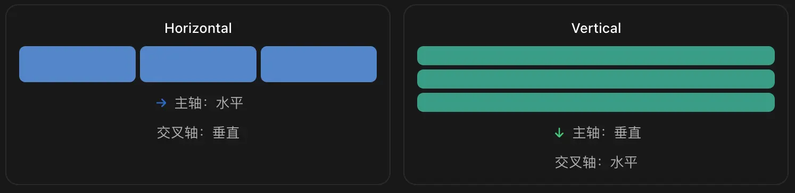
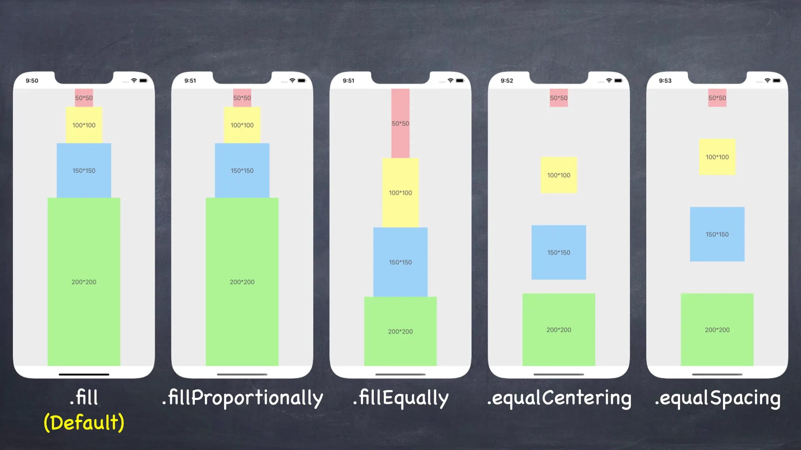
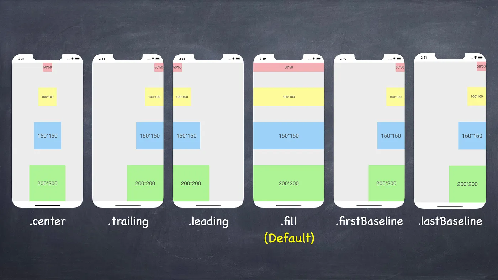
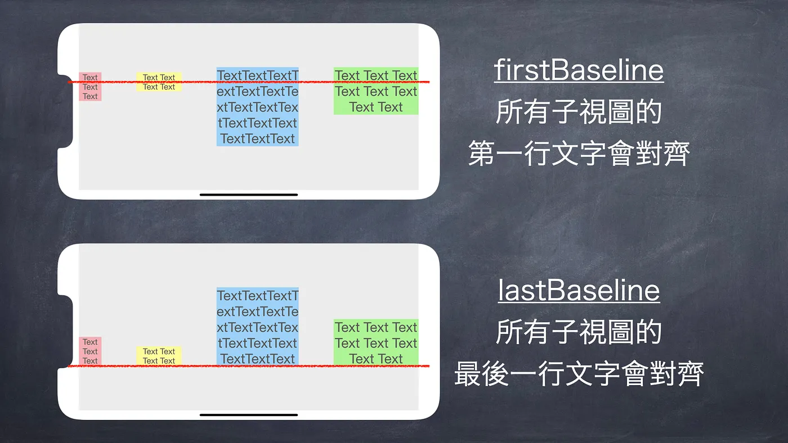
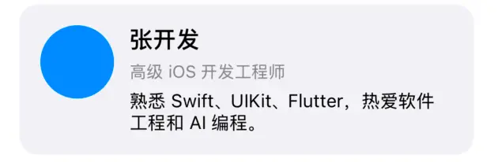

## 1. UIStackView介绍

### 1.1 基本概念

`UIStackView `它最擅长的是将一组 View 按行或列排列，并根据内容和约束自动调整尺寸。关键信息是:
- 将多个视图排列成一行或一列，
- 根据内容和约束自动调整尺寸（内部利用 Auto Layout）。

UIStackView 有两个方向：主轴和交叉轴。



记住两条规则，这是整个 UIStackView API 体系的核心：

- `distribution`：决定子视图沿着主轴如何分配空间。
- `alignment`：决定子视图沿着交叉轴如何对齐。

### 1.2 第一个例子
```swift
private let stackView = UIStackView()

override func viewDidLoad() {
    super.viewDidLoad()
    view.backgroundColor = .systemBackground

    // 1. 创建三个子视图
    let redView = UIView()
    redView.backgroundColor = .systemRed

    let greenView = UIView()
    greenView.backgroundColor = .systemGreen

    let blueView = UIView()
    blueView.backgroundColor = .systemBlue

    // 2. 配置 UIStackView
    stackView.axis = .horizontal  // 主轴方向，水平布局
    stackView.distribution = .fillEqually  // 主轴方向分配方式，子视图等比例分配空间
    stackView.alignment = .fill  // 交叉轴方向，子视图填充
    stackView.spacing = 12  // 子视图间距

    // 3. 添加排列子视图
    stackView.addArrangedSubview(redView)
    stackView.addArrangedSubview(greenView)
    stackView.addArrangedSubview(blueView)

    // 4. 将 StackView 添加到页面
    view.addSubview(stackView)

    // 5. 只需要约束 StackView 自身的位置和大小
    stackView.snp.makeConstraints { make in
        make.top.equalTo(view.safeAreaLayoutGuide).offset(30)
        make.leading.trailing.equalToSuperview().inset(20)
        make.height.equalTo(80)
    }
}
// 这里没有为三个子视图单独写宽度约束。因为 UIStackView 会根据子视图的内容和约束自动调整尺寸。
```

> UIStackView 负责排列内部 View，但它自己的位置和尺寸仍然要由外部约束或者布局环境决定。


## 2.UIStackView 核心属性

### 2.1 核心属性

`UIStackView` 的核心属性并不多：

| 属性                  | 类型/值            | 作用        |
| -------------- | ----------------- | ------------- |
| `axis`  | `.horizontal` 水平布局 <br> `.vertical` 垂直布局 | 决定主轴方向     |
| `distribution` | `.full`填满(默认) <br> `.fillEqually`等比例分配空间 <br> `.fillProportionally`按原有比例填满 <br> `.equalSpacing` 等间距 <br> `.equalCentering` 中心等间距 | 主轴空间分配规则 |
| `alignment`                          | `.full`拉伸填满(默认) <br> `.leading`/`.top` 靠前/靠顶 <br> `.center` 居中对齐 <br> `.trailing`/`.bottom` 靠后/靠底 <br> `.firstBaseline`/`.lastBaseline` 文本基线对齐 | 交叉轴对齐方式 |
| `spacing`                            | `CGFloat`     | 相邻子视图间距   |
| `arrangedSubviews`                   | `[UIView]`  | 被管理的排列子视图    |
| `isLayoutMarginsRelativeArrangement` | `Bool`  | 是否启用外边距（Margins）相对布局。设置为 `true` 后，StackView 才会应用上下左右的内边距      |
| `directionalLayoutMargins`           | `NSDirectionalEdgeInsets`  | 当 `isLayoutMarginsRelativeArrangement` 为 `true` 时，用于设置 `StackView` 容器四周的内边距（自动适配 RTL 语言） |
| `isBaselineRelativeArrangement`      | `Bool`  | 垂直排列时是否基于文本基线计算间距  |


### 2.2 `axis`排列方向

这个属性可以动态修改：
```swift
stackView.axis = .vertical

UIView.animate(withDuration: 0.3) {
    self.view.layoutIfNeeded()
}
```

`UIStackView` 改变 `axis` 时会更新内部排列约束，不需要你手动重新创建 `arrangedSubviews`。


### 2.3 distribution五种主轴分配策略

图示：


#### 2.3.1 `.full`根据内容和优先级填充(默认)

当空间多于子视图需要的尺寸时，系统根据 Content Hugging Priority 决定哪些视图被拉伸。

当空间不足时，系统根据 Compression Resistance Priority 决定哪些视图被压缩。

这是实现「左边自适应文字、右边固定按钮」的理想选择。代码示例：
```swift
let titleLabel = UILabel()
titleLabel.text = "这是一个可能很长的标题"
titleLabel.textColor = .black
titleLabel.backgroundColor = UIColor.yellow
titleLabel.lineBreakMode = .byTruncatingTail

let button = UIButton(type: .system)
button.setTitle("操作", for: .normal)
button.backgroundColor = UIColor.green

let stack = UIStackView(arrangedSubviews: [titleLabel, button])

stack.backgroundColor = .gray
stack.axis = .horizontal
stack.distribution = .fill
stack.alignment = .center
stack.spacing = 12
view.addSubview(stack)

// 标题允许优先被压缩
titleLabel.setContentCompressionResistancePriority(.defaultLow, for: .horizontal)

// 按钮尽量保持完整
button.setContentCompressionResistancePriority(.required, for: .horizontal)
// 按钮不希望被额外拉宽
button.setContentHuggingPriority(.required, for: .horizontal)

stack.snp.makeConstraints { make in
    make.top.equalTo(view.safeAreaLayoutGuide).offset(30)
    make.leading.trailing.equalToSuperview().inset(30)
    make.height.equalTo(60)
}
```

#### 2.3.2 `.fillEqually`等宽或等高

- 横向 StackView：所有 `arrangedSubview` 等宽。
- 纵向 StackView：所有 `arrangedSubview` 等高。

适合：

- 两个套餐卡片平分宽度。
- 三个 Tab 按钮等宽排列。
- 多个操作按钮平分容器空间。

但如果子视图高度由动态文本决定，纵向使用 `.fillEqually` 可能不是你想要的结果，因为它会要求每一个子视图等高。

#### 2.3.3 `.fillProportionally`根据固有内容尺寸比例分配

假设两个子视图的固有内容宽度分别为 100 和 200，那么空间充足时，它们会倾向于维持约 1:2 的宽度比例。

但这里有个重点：

`.fillProportionally` 依据的是 Intrinsic Content Size，不是你给 UIView 设置的 Frame，也不是一个通用的 `flex: 1`、`flex: 2` 系统。

对于普通 UIView：

```
let a = UIView()
let b = UIView()
```

由于它们默认没有有效的固有内容尺寸，直接依赖 `.fillProportionally` 获得 `1:2` 比例并不可靠。

如果你需要严格 `1:2` 的比例，更推荐明确写约束：

```swift
let stack = UIStackView(arrangedSubviews: [a, b])
stack.axis = .horizontal
stack.distribution = .fill
stack.spacing = 12

// B 的宽度 = A 的宽度 × 2
b.snp.makeConstraints { make in
    make.width.equalTo(a.snp.width).multipliedBy(2)
}

// 这时：比依赖固有内容尺寸更可控。(⚠️ 需要 a 和 b 有 intrinsicContentSize)
```

#### 2.3.4 `.equalSpacing`相邻间距相等

适合三个操作图标之间平均分布空间。

要注意，`spacing` 在这种模式下通常代表最小间距，而实际间隔可能更大。

#### 2.3.5 `.equalCentering`中心点均匀分布

与 `.equalSpacing` 不同，它倾向于让每个子视图中心之间距离相同。

当子视图宽度明显不同，两者的效果更容易区分。

例如三个不同尺寸的圆形按钮或操作控件，可能更适合中心点等距分布。


### 2.4 alignment交叉轴对齐

这里经常与 `distribution` 混淆。
- 如果 `axis = .horizontal`，`alignment` 管理纵向对齐。
- 如果 `axis = .vertical`，`alignment` 管理横向对齐。

| Alignment        | 横向 StackView | 纵向 StackView |
| ---------------- | ------------ | ------------ |
| `.fill`          | 尽量填满高度       | 尽量填满宽度       |
| `.leading`       | 不适用          | 靠 Leading 侧  |
| `.trailing`      | 不适用          | 靠 Trailing 侧 |
| `.top`           | 顶部对齐         | 不适用          |
| `.bottom`        | 底部对齐         | 不适用          |
| `.center`        | 垂直居中         | 水平居中         |
| `.firstBaseline` | 第一文本基线对齐     | 不适用          |
| `.lastBaseline`  | 最后一条文本基线对齐   | 不适用          |


对于 `UIStackView.Alignment`，这些值需要结合 axis 使用，不是所有值都适用于两种方向。





**示例：不同字体的文本基线对齐**

```swift
let priceLabel = UILabel()
priceLabel.text = "¥198"
priceLabel.font = .boldSystemFont(ofSize: 30)

let periodLabel = UILabel()
periodLabel.text = "/年"
periodLabel.font = .systemFont(ofSize: 13)

let stack = UIStackView(arrangedSubviews: [
    priceLabel,
    periodLabel
])

stack.axis = .horizontal
stack.distribution = .fill
stack.alignment = .lastBaseline
stack.spacing = 4
// 这是商业 App 中价格展示的典型做法。
```

### 2.5 spacing统一间距

控制相邻 `arrangedSubviews` 之间的间距。

但是在 `.equalSpacing`、`.equalCentering` 等分配方式下，实际间隔可能根据空间调整，不能机械地把所有间距都当成固定值。


## 3.常用方法

### 3.1 UIStackView 常用方法一览

| 方法或属性                          | 作用                                  |
| ------------------------------ | ----------------------------------- |
| `init(arrangedSubviews:)`      | 创建并初始化排列子视图                         |
| `addArrangedSubview(_:)`       | 追加一个排列子视图                           |
| `insertArrangedSubview(_:at:)` | 在指定位置插入                             |
| `removeArrangedSubview(_:)`    | 停止排列管理，但不移出视图层级                     |
| `arrangedSubviews`             | 获取当前排列数组                            |
| `setCustomSpacing(_:after:)`   | 为指定 View 后面设置特殊间距                   |
| `customSpacing(after:)`        | 读取特殊间距                              |
| `removeFromSuperview()`        | 移除 View；若是 arrangedSubview，也会退出排列数组 |
| `isHidden`                     | 隐藏一个 arrangedSubview，并使布局通常自动收拢     |

### 3.2 arrangedSubviews 与 subviews 有什么区别？

这是 UIStackView 最重要的底层概念之一。

所有 `arrangedSubviews` 都属于 `subviews`，但并非所有 `subviews` 都属于 `arrangedSubviews`。

```swift
let stack = UIStackView()

let a = UIView()
let b = UIView()
let c = UIView()

stack.addArrangedSubview(a)
stack.addArrangedSubview(b)

// c 是普通子视图，不受 StackView 排列规则管理
stack.addSubview(c)
```

此时：

```swift
stack.arrangedSubviews // [a, b]
stack.subviews         // 包含 a、b、c
```

在实际工程中，绝大多数需要排列的子视图都应该通过 `addArrangedSubview` 添加。

`addSubview` 可以用于装饰性视图或特殊覆盖层，但需要自己管理其位置。

Apple 文档还强调：`arrangedSubviews` 顺序决定排列位置，`subviews` 顺序决定视图的 Z-order。

官方文档：https://developer.apple.com/documentation/uikit/uistackview

### 3.3 addArrangedSubview 和 insertArrangedSubview

```swift
// 在最后添加
stack.addArrangedSubview(newView)

// 插入到第一个位置
stack.insertArrangedSubview(newView, at: 0)
```

### 3.4 removeArrangedSubview 的陷阱

假设：

```swift
stack.removeArrangedSubview(a)
```

这一步只代表：

> StackView 不再管理 a 的排列。

并不代表 `a` 被从屏幕移除。

如果想完整删除一个 `arrangedSubview`，通常应该：

```swift
stack.removeArrangedSubview(a)
a.removeFromSuperview()
```

也可以直接：

```swift
a.removeFromSuperview()
```
当它原本是 StackView 的 `arrangedSubview` 时，这样会同时将它从排列数组中移除。

**清空所有 `arrangedSubviews`**：

```swift
func removeAllArrangedSubviews(from stack: UIStackView) {
    stack.arrangedSubviews.forEach { view in
        view.removeFromSuperview()
    }
}
// 如果你需要清空后重新构造整个布局，可以使用这种方法。
```

### 3.5 isHidden：UIStackView 一个非常实用的特性

普通 UIView 隐藏后：

```swift
view.isHidden = true
```

通常只是不可见，它的其他布局约束仍然存在。

而 `UIStackView` 对 `arrangedSubview` 的隐藏有特殊处理：它会调整内部排列布局，使隐藏的项通常不再占用主轴排列空间。

例如：

```swift
let detailLabel = UILabel()
detailLabel.numberOfLines = 0
detailLabel.text = "这是一段可以展开收起的说明。"

stack.addArrangedSubview(detailLabel)

// 隐藏后，StackView 自动重新排列
detailLabel.isHidden = true
```

但这里有一个高级陷阱：

如果隐藏的 View 同时具有你额外添加的 Required 高度约束，StackView 试图压缩它时可能出现约束冲突。

例如：

```swift
detailView.snp.makeConstraints { make in
    make.height.equalTo(100)
}
```

如果将来要隐藏它，最好考虑：

```swift
detailView.snp.makeConstraints { make in
    make.height.equalTo(100).priority(999)
}
```

或者在隐藏时停用相关高度约束。

不是所有隐藏问题都需要把优先级改成 999；应该先分析是否存在外部约束与 StackView 的隐藏约束冲突。

### 3.6 setCustomSpacing：局部间距


假设你的页面是：

```
标题
8pt
副标题
24pt
权益列表
16pt
操作按钮
```

完全可以使用一个纵向 StackView：
```swift
let stack = UIStackView(
    arrangedSubviews: [
        titleLabel,
        subtitleLabel,
        benefitsView,
        actionButton
    ]
)

stack.axis = .vertical
stack.spacing = 16

// 标题之后只间隔 8
stack.setCustomSpacing(8, after: titleLabel)

// 副标题之后间隔 24
stack.setCustomSpacing(24, after: subtitleLabel)
```

注意：

- 应先将目标 View 加入 `arrangedSubviews`，再设置 custom spacing。
- 特殊间距属于某个 View 的「后方间距」。
- 当 View 隐藏或移除时，相关间距表现可能发生变化。
- 如果业务上需要始终保留一组独立的间距关系，嵌套 StackView 往往更清晰。


## 4.UIStackView + SnapKit
两者的职责分工：
`UIStackView` 负责内部排列，`SnapKit` 负责外部定位、比例和特殊约束。

### 4.1 个人信息卡片示例

代码示例：


```swift
import UIKit
import SnapKit

final class ProfileCardView: UIView {

    private let avatarView = UIImageView()
    private let nameLabel = UILabel()
    private let jobLabel = UILabel()
    private let bioLabel = UILabel()

    private let verticalStack = UIStackView()
    private let horizontalStack = UIStackView()

    override init(frame: CGRect) {
        super.init(frame: frame)
        setupUI()
        setupConstraints()
    }

    required init?(coder: NSCoder) {
        fatalError("init(coder:) has not been implemented")
    }

    private func setupUI() {
        backgroundColor = .secondarySystemBackground
        layer.cornerRadius = 14

        avatarView.backgroundColor = .systemBlue
        avatarView.layer.cornerRadius = 28
        avatarView.clipsToBounds = true

        nameLabel.text = "张开发"
        nameLabel.font = .boldSystemFont(ofSize: 18)

        jobLabel.text = "高级 iOS 开发工程师"
        jobLabel.font = .systemFont(ofSize: 13)
        jobLabel.textColor = .secondaryLabel

        bioLabel.text = "熟悉 Swift、UIKit、Flutter，热爱软件工程和 AI 编程。"
        bioLabel.font = .systemFont(ofSize: 14)
        bioLabel.numberOfLines = 0

        // 右侧纵向排列
        verticalStack.axis = .vertical
        verticalStack.alignment = .fill
        verticalStack.distribution = .fill
        verticalStack.spacing = 6

        verticalStack.addArrangedSubview(nameLabel)
        verticalStack.addArrangedSubview(jobLabel)
        verticalStack.addArrangedSubview(bioLabel)

        // 整体横向排列
        horizontalStack.axis = .horizontal
        horizontalStack.alignment = .top
        horizontalStack.distribution = .fill
        horizontalStack.spacing = 12

        horizontalStack.addArrangedSubview(avatarView)
        horizontalStack.addArrangedSubview(verticalStack)

        addSubview(horizontalStack)
    }

    private func setupConstraints() {
        // 头像固定尺寸
        avatarView.snp.makeConstraints { make in
            make.size.equalTo(56)
        }

        // 内容区域距离卡片四周 16
        horizontalStack.snp.makeConstraints { make in
            make.edges.equalToSuperview().inset(16)
        }

        // 让头像优先保持固定宽度 （大部分情况下，头像宽度固定，不需要压缩。不用下面这句代码也没事）
        avatarView.setContentCompressionResistancePriority(.required, for: .horizontal)
    }
}
```

作为对比，下面是不使用`UIStackView`的代码示例：
```swift
final class ProfileCardView: UIView {

    private let avatarView = UIImageView()
    private let nameLabel = UILabel()
    private let jobLabel = UILabel()
    private let bioLabel = UILabel()

    override init(frame: CGRect) {
        super.init(frame: frame)
        setupUI()
        setupConstraints()
    }

    required init?(coder: NSCoder) {
        fatalError("init(coder:) has not been implemented")
    }

    private func setupUI() {
        backgroundColor = .secondarySystemBackground
        layer.cornerRadius = 14

        avatarView.backgroundColor = .systemBlue
        avatarView.layer.cornerRadius = 28
        avatarView.clipsToBounds = true

        nameLabel.text = "张开发"
        nameLabel.font = .boldSystemFont(ofSize: 18)

        jobLabel.text = "高级 iOS 开发工程师"
        jobLabel.font = .systemFont(ofSize: 13)
        jobLabel.textColor = .secondaryLabel

        bioLabel.text = "熟悉 Swift、UIKit、Flutter，热爱软件工程和 AI 编程。"
        bioLabel.font = .systemFont(ofSize: 14)
        bioLabel.numberOfLines = 0

        [avatarView, nameLabel, jobLabel, bioLabel].forEach {
            addSubview($0)
        }
    }

    private func setupConstraints() {
        // 头像固定尺寸
        avatarView.snp.makeConstraints { make in
            make.size.equalTo(56)
            make.top.leading.equalToSuperview().offset(16)
            // 最小高度兜底：头像底部不超出卡片
            make.bottom.lessThanOrEqualToSuperview().offset(-16)
        }
        // 让头像优先保持固定宽度
        avatarView.setContentCompressionResistancePriority(
            .required,
            for: .horizontal
        )
        
        nameLabel.snp.makeConstraints { make in
            make.leading.equalTo(avatarView.snp.trailing).offset(12)
            make.trailing.equalToSuperview().inset(16)
            make.top.equalTo(avatarView)
        }
        jobLabel.snp.makeConstraints { make in
            make.top.equalTo(nameLabel.snp.bottom).offset(6)
            make.leading.trailing.equalTo(nameLabel)
        }
        bioLabel.snp.makeConstraints { make in
            make.top.equalTo(jobLabel.snp.bottom).offset(6)
            make.leading.trailing.equalTo(nameLabel)
            // 高度闭合：bioLabel 底部贴卡片底部,内容多时由 bioLabel 撑开卡片高度
            make.bottom.lessThanOrEqualToSuperview().offset(-16).priority(.high)
        }
        
        //  允许 bioLabel 纵向压缩，避免与外部高度约束冲突
        bioLabel.setContentCompressionResistancePriority(.defaultLow, for: .vertical)
    }
}
```

### 4.2 和 UIScrollView 一起使用

很多商业页面适合：

```
UIScrollView
└── contentLayoutGuide
    └── verticalStack
        ├── heroView
        ├── descriptionView
        ├── featureView
        ├── planView
        └── footerView
```

重点是：UIScrollView 负责滚动，UIStackView 负责纵向排列。

示例：

```swift
let scrollView = UIScrollView()
let stack = UIStackView()

stack.axis = .vertical
stack.spacing = 20
stack.alignment = .fill

view.addSubview(scrollView)
scrollView.addSubview(stack)

scrollView.snp.makeConstraints { make in
    make.edges.equalTo(view.safeAreaLayoutGuide)
}

stack.snp.makeConstraints { make in
    // 与 ScrollView 内容区域关联
    make.edges.equalTo(scrollView.contentLayoutGuide).inset(20)
    // 限制实际内容宽度，不发生横向滚动
    make.width.equalTo(scrollView.frameLayoutGuide).offset(-40)
}
```

然后添加各组件：

```swift
stack.addArrangedSubview(heroView)
stack.addArrangedSubview(descriptionView)
stack.addArrangedSubview(featureView)
```

只要纵向内容高度能够被完整求解，ScrollView 就可以根据内容决定可滚动范围。

但要避免无约束高度的普通 UIView 被放进纵向 StackView 后，期待它自动撑开。普通 UIView 通常没有有效的固有内容高度。

## 5.动态布局、动画与响应式适配

接下来学习 UIStackView 最有价值的能力：动态增加、删除、隐藏视图，以及改变排列方向。

### 5.1 动态设置表单

这个案例包含：

- 垂直 `UIStackView`。
- 嵌套的水平 `UIStackView`。
- 点击按钮添加表单项。
- 删除表单项。
- 展开、收起高级设置。
- `SnapKit` + `UIScrollView`。
- 动画更新。

下面是一个可独立运行的 UIKit 示例。它使用 `UIStackView` 自动管理动态表单高度。

```swift
import UIKit
import SnapKit

final class DynamicFormViewController: UIViewController {

    private let scrollView = UIScrollView()

    private let formStack: UIStackView = {
        let stack = UIStackView()
        stack.axis = .vertical
        stack.alignment = .fill
        stack.distribution = .fill
        stack.spacing = 16
        return stack
    }()

    private let addButton: UIButton = {
        let button = UIButton(type: .system)
        button.setTitle("添加字段", for: .normal)
        return button
    }()

    private let advancedButton: UIButton = {
        let button = UIButton(type: .system)
        button.setTitle("展开高级设置", for: .normal)
        return button
    }()

    private let advancedStack: UIStackView = {
        let stack = UIStackView()
        stack.axis = .vertical
        stack.spacing = 12
        stack.alignment = .fill
        return stack
    }()

    private var fieldCount = 0
    private var isExpanded = false

    override func viewDidLoad() {
        super.viewDidLoad()

        view.backgroundColor = .systemBackground
        title = "动态表单"

        setupUI()
        setupConstraints()
        setupActions()

        addField(title: "服务器地址")
        addField(title: "用户名")
    }

    private func setupUI() {
        view.addSubview(scrollView)
        scrollView.addSubview(formStack)

        // 创建高级设置内容
        let retryLabel = UILabel()
        retryLabel.text = "自动重试：开启"

        let timeoutLabel = UILabel()
        timeoutLabel.text = "超时时间：30 秒"

        advancedStack.addArrangedSubview(retryLabel)
        advancedStack.addArrangedSubview(timeoutLabel)

        // 初始不显示高级设置
        advancedStack.isHidden = true

        formStack.addArrangedSubview(addButton)
        formStack.addArrangedSubview(advancedButton)
        formStack.addArrangedSubview(advancedStack)
    }

    private func setupConstraints() {
        scrollView.snp.makeConstraints { make in
            make.edges.equalTo(view.safeAreaLayoutGuide)
        }

        formStack.snp.makeConstraints { make in
            make.edges.equalTo(
                scrollView.contentLayoutGuide
            ).inset(20)

            make.width.equalTo(
                scrollView.frameLayoutGuide
            ).offset(-40)
        }

        addButton.snp.makeConstraints { make in
            make.height.equalTo(48)
        }

        advancedButton.snp.makeConstraints { make in
            make.height.equalTo(44)
        }
    }

    private func setupActions() {
        addButton.addTarget(
            self,
            action: #selector(addTapped),
            for: .touchUpInside
        )

        advancedButton.addTarget(
            self,
            action: #selector(advancedTapped),
            for: .touchUpInside
        )
    }

    // MARK: - 添加字段

    @objc private func addTapped() {
        fieldCount += 1
        addField(title: "自定义字段 \(fieldCount)")
    }

    private func addField(title: String) {

        // 每个字段是一个独立的垂直 StackView
        let fieldStack = UIStackView()
        fieldStack.axis = .vertical
        fieldStack.spacing = 8
        fieldStack.alignment = .fill

        let titleLabel = UILabel()
        titleLabel.text = title
        titleLabel.font = .systemFont(ofSize: 14)

        let textField = UITextField()
        textField.placeholder = "请输入\(title)"
        textField.borderStyle = .roundedRect

        // UITextField 有固有内容高度，
        // 这里显式指定最小高度，方便点击
        textField.snp.makeConstraints { make in
            make.height.greaterThanOrEqualTo(44)
        }

        // 删除按钮
        let deleteButton = UIButton(type: .system)
        deleteButton.setTitle("删除", for: .normal)

        // 顶部标题与删除按钮水平排列
        let headerStack = UIStackView(
            arrangedSubviews: [titleLabel, deleteButton]
        )

        headerStack.axis = .horizontal
        headerStack.alignment = .center
        headerStack.distribution = .fill
        headerStack.spacing = 12

        // 标题可以优先压缩
        titleLabel.setContentCompressionResistancePriority(
            .defaultLow,
            for: .horizontal
        )

        fieldStack.addArrangedSubview(headerStack)
        fieldStack.addArrangedSubview(textField)

        // 在添加按钮之前插入新字段
        let index = formStack.arrangedSubviews.firstIndex(
            of: addButton
        ) ?? 0

        formStack.insertArrangedSubview(
            fieldStack,
            at: index
        )

        // 删除对应的表单组件
        deleteButton.addAction(
            UIAction { [weak self, weak fieldStack] _ in
                guard let self,
                      let fieldStack else { return }

                // 直接移出父视图，也会退出 arrangedSubviews
                fieldStack.removeFromSuperview()

                self.animateLayout()
            },
            for: .touchUpInside
        )

        animateLayout()
    }

    // MARK: - 高级设置展开 / 收起

    @objc private func advancedTapped() {

        isExpanded.toggle()

        // 动画前确保旧布局已经完成
        view.layoutIfNeeded()

        advancedStack.isHidden = !isExpanded

        let title = isExpanded
            ? "收起高级设置"
            : "展开高级设置"

        advancedButton.setTitle(title, for: .normal)

        animateLayout()
    }

    // MARK: - Animation

    private func animateLayout() {

        if UIAccessibility.isReduceMotionEnabled {
            view.layoutIfNeeded()
            return
        }

        UIView.animate(
            withDuration: 0.3,
            delay: 0,
            options: [.curveEaseInOut]
        ) {
            self.view.layoutIfNeeded()
        }
    }
}
```

### 5.2 响应式布局：横向切换纵向

例如：
```swift
private func updateStackAxis(for size: CGSize) {

    let targetAxis: NSLayoutConstraint.Axis =
        size.width > size.height
            ? .vertical
            : .horizontal

    guard planStack.axis != targetAxis else {
        return
    }

    view.layoutIfNeeded()

    planStack.axis = targetAxis

    UIView.animate(withDuration: 0.3) {
        self.view.layoutIfNeeded()
    }
}
```

这里不需要 SnapKit `remakeConstraints`。

但要注意一个潜在问题：如果你同时为子视图设置了只适用于横向排列的尺寸约束，改变 axis 后可能出现冲突。

例如横向时：

```swift
make.width.equalTo(100)
```

纵向时又要求：

```swift
make.width.equalToSuperview()
```

如果两条约束互相矛盾，UIStackView 无法替你解决。

UIStackView 管理排列，不代表它可以自动消除所有外部约束冲突。

## 6.高级原理

### 6.1 UIStackView 底层如何工作？

你可以把它理解为一个约束生成和管理器。

当我们执行：

```swift
stack.axis = .horizontal
stack.distribution = .fillEqually
stack.spacing = 12
```

UIStackView 会在内部建立和维护相应的 Auto Layout 关系。

例如三个视图：

```
StackView
├── A
├── B
└── C
```

其布局可以概念化为：
 - A.trailing + 12 = B.leading
 - B.trailing + 12 = C.leading
 - A.width = B.width = C.width

### 6.2 UIStackView 与 SnapKit 的职责区别

| 能力         | UIStackView    | SnapKit                  |
| ---------- | -------------- | ------------------------ |
| 横向 / 纵向排列  | 非常适合           | 可以实现                     |
| 等宽排列       | `.fillEqually` | 等宽约束                     |
| 固定间距       | `spacing`      | offset/inset             |
| 动态增加子视图    | 简单             | 需要维护约束                   |
| 内容驱动高度     | 支持             | 支持                       |
| 16:9 比例    | 不直接提供比例 API    | 非常适合                     |
| 与父视图安全区域对齐 | 仍需外部布局规则       | 非常适合                     |
| 重叠 / 浮层布局  | 不适合            | 更适合                      |
| 自动换行网格     | 不支持            | 需要专门设计或改用 CollectionView |


一句话概括：

> `UIStackView` 解决「如何排列」，`SnapKit` 解决「建立什么约束关系」。两者不是竞争关系，而是互补关系。

### 6.3 哪些场景特别适合 UIStackView？

我会优先将它用于这些商业 App 组件：

- 用户信息卡片、头像与昵称排列。
- 设置页中的简单分组内容。
- 登录注册表单。
- 商品价格与单位展示。
- 操作按钮组。
- 会员权益列表。
- 展开收起的详情区域。
- 内容较少、结构稳定的垂直页面。
- 需要横竖布局切换的简单组件。

**哪些场景不建议使用？**

第一类：大量可复用列表项。

例如几百条动态数据，不推荐一次性创建几百个 UIView 全部加入 UIStackView。

更适合使用 UITableView 或 UICollectionView，因为它们具备可复用 Cell、按需加载等能力。

第二类：瀑布流或复杂网格。

UIStackView 只能沿单个轴排列，没有内置的自动换行布局。

适合使用 UICollectionView、Compositional Layout 或自定义 Layout。

第三类：自由定位、重叠和特殊动画。

例如图片上的多个浮层、可拖动节点、画布编辑器等。

这些更适合使用 SnapKit、Frame 或自定义布局逻辑。

### 6.4 常见陷阱

| 问题                                 | 根本原因                       | 推荐方案                 |
| ---------------------------------- | -------------------------- | -------------------- |
| 子视图宽高变成 0                          | 普通 UIView 缺少有效尺寸信息         | 提供固有尺寸或明确约束          |
| `.fill` 拉伸了不想拉伸的 View              | Hugging Priority 不合理       | 调整抗拉伸优先级             |
| 文本被意外截断                            | Compression Resistance 不合理 | 调整抗压缩优先级             |
| 隐藏 View 出现约束冲突                     | 外部 Required 尺寸与隐藏状态冲突      | 修改、停用或降低相关约束优先级      |
| `removeArrangedSubview` 后 View 仍显示 | 只移除了排列管理                   | 同时移出视图层级             |
| 嵌套 StackView 太多，难以调试               | 结构过度复杂                     | 适当抽取自定义 UIView，简化布局树 |

特别强调最后一点。

StackView 不是越多越好。一个用户信息卡片用两个 StackView 很合理，但如果一个简单 Cell 嵌套七八层 StackView，排查约束和性能问题就会变得困难。

对于复杂布局，可以结合 SnapKit 减少不必要的嵌套层级。


### 6.5 工程实践规范

对于后续使用 Swift + UIKit + SnapKit 开发新项目，我建议形成以下约定：

第一，优先使用 `UIStackView(arrangedSubviews:)` 创建固定排列结构。

```swift
let stack = UIStackView(arrangedSubviews: [
    titleLabel,
    subtitleLabel,
    actionButton
])
```

第二，普通 UIView 组件自己负责内部布局，ViewController 负责页面级组合。

不要让 ViewController 直接管理几十个 UILabel、UIImageView 的具体位置。

第三，视图状态由业务数据驱动。

例如用户权限发生变化时：

```swift
func render(isVIP: Bool) {
    vipBadge.isHidden = !isVIP
    premiumFeatureView.isHidden = !isVIP
}
```
不必每次都删除并重建整个布局。

第四，动态布局优先调整属性，而不是重建约束。

例如：

```swift
stack.axis = .vertical
stack.spacing = 20
descriptionView.isHidden = false
```

如果这些操作已经足够，就没有必要调用 `remakeConstraints`。

第五，动态内容必须经过布局优先级和极端内容测试。

尤其是长文本、不同语言、Dynamic Type，以及不同大小的窗口。


